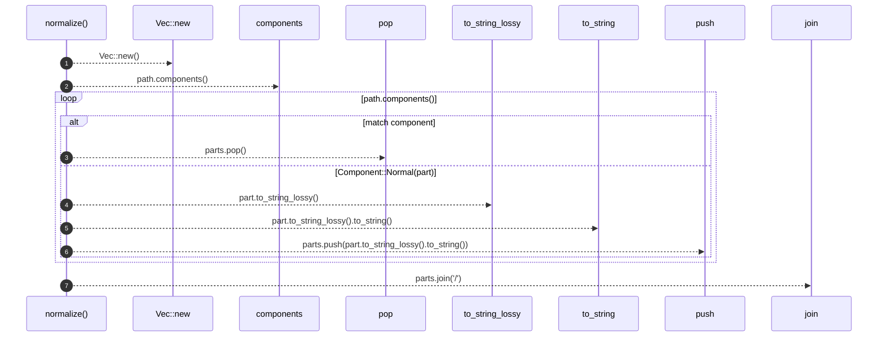

# `robby_render::test_tree::normalize`

[Self-model](../../README.md) · [test_tree](index.md)

| | |
|---|---|
| kind | `code.function` |
| signature | `fn normalize(path: &Path) -> String` |
| location | [`crates/robby-render/tests/tree.rs:164`](../../../../crates/robby-render/tests/tree.rs#L164) |
| provenance | extractor · confidence 1.00 |

```rust
fn normalize(path: &Path) -> String {
    let mut parts: Vec<String> = Vec::new();
    for component in path.components() {
        match component {
            Component::ParentDir => {
                parts.pop();
            }
            Component::Normal(part) => parts.push(part.to_string_lossy().to_string()),
            Component::CurDir | Component::Prefix(_) | Component::RootDir => {}
        }
    }
    parts.join("/")
}
```



7 steps · 0 observed · 7 possible only

**Edges**

- calls → [`robby_render::report::impl Report::new`](../report/index.md)
- calls → [`robby_render::report::impl Report::push`](../report/index.md)

## References

- calls → [`robby_render::report`](../report/index.md) — new, push

## Referenced by

- calls ← [`robby_render::test_tree::every_internal_link_resolves`](every-internal-link-resolves.md)

