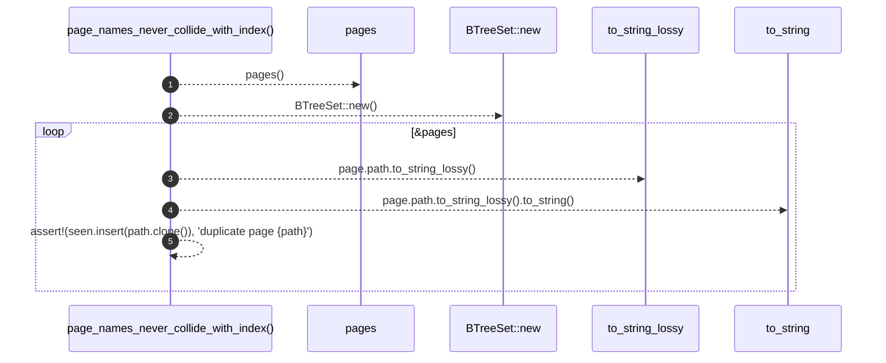

# `robby_render::test_tree::page_names_never_collide_with_index`

[Self-model](../../README.md) · [test_tree](index.md)

| | |
|---|---|
| kind | `code.function` |
| signature | `fn page_names_never_collide_with_index()` |
| location | [`crates/robby-render/tests/tree.rs:93`](../../../../crates/robby-render/tests/tree.rs#L93) |
| provenance | extractor · confidence 1.00 |

```rust
#[test]
fn page_names_never_collide_with_index() {
    let (_, pages) = pages();
    let mut seen = BTreeSet::new();
    for page in &pages {
        let path = page.path.to_string_lossy().to_string();
        assert!(seen.insert(path.clone()), "duplicate page {path}");
    }
}
```



5 steps · 0 observed · 5 possible only

**Edges**

- calls → [`robby_render::test_tree::pages`](pages.md)
- calls → [`robby_render::report::impl Report::new`](../report/index.md)

## References

- calls → [`robby_render::report`](../report/index.md) — new
- calls → [`robby_render::test_tree`](index.md) — pages

