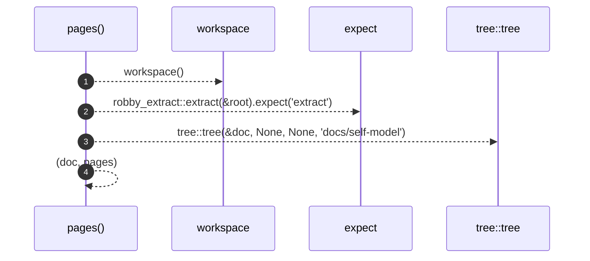

# `robby_render::test_tree::pages`

[Self-model](../../README.md) · [test_tree](index.md)

| | |
|---|---|
| kind | `code.function` |
| signature | `fn pages() -> (robby_ir::Document, Vec<tree::Page>)` |
| location | [`crates/robby-render/tests/tree.rs:13`](../../../../crates/robby-render/tests/tree.rs#L13) |
| provenance | extractor · confidence 1.00 |

```rust
fn pages() -> (robby_ir::Document, Vec<tree::Page>) {
    let root = workspace();
    let doc = robby_extract::extract(&root).expect("extract");
    let pages = tree::tree(&doc, None, None, "docs/self-model");
    (doc, pages)
}
```



4 steps · 0 observed · 4 possible only

**Edges**

- calls → [`robby_render::test_tree::workspace`](workspace.md)
- calls → [`robby_render::tree::tree`](../tree/tree.md)

