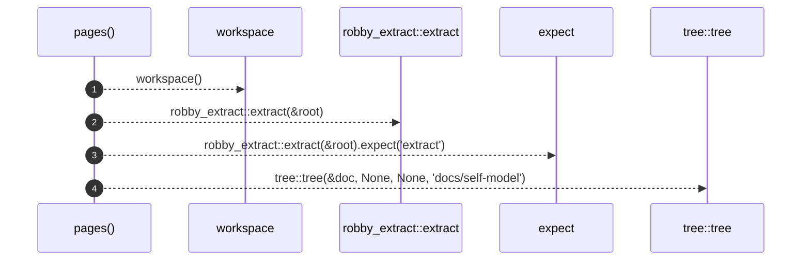

# `robby_render::test_tree::pages`

[Self-model](../../README.md) · [test_tree](index.md)

| | |
|---|---|
| kind | `code.function` |
| signature | `fn pages() -> (robby_ir::Document, Vec<tree::Page>)` |
| location | [`crates/robby-render/tests/tree.rs:13`](../../../../crates/robby-render/tests/tree.rs#L13) |
| provenance | extractor · confidence 1.00 |

```rust
fn pages() -> (robby_ir::Document, Vec<tree::Page>) {
    let root = workspace();
    let doc = robby_extract::extract(&root).expect("extract");
    let pages = tree::tree(&doc, None, None, "docs/self-model");
    (doc, pages)
}
```



4 steps · 0 observed · 4 possible only

**Edges**

- calls → [`robby_render::test_tree::workspace`](workspace.md)
- calls → [`robby_cli::extract`](../../robby_cli/extract.md)
- calls → [`robby_render::tui::tree`](../tui/tree.md)

## References

- calls → [`robby_cli`](../../robby_cli/index.md) — extract
- calls → [`robby_render::test_tree`](index.md) — workspace
- calls → [`robby_render::tui`](../tui/index.md) — tree

## Referenced by

- calls ← [`robby_render::test_tree::every_internal_link_resolves`](every-internal-link-resolves.md)
- calls ← [`robby_render::test_tree::every_module_has_an_index_page`](every-module-has-an-index-page.md)
- calls ← [`robby_render::test_tree::modules_link_out_and_back`](modules-link-out-and-back.md)
- calls ← [`robby_render::test_tree::no_page_is_a_wall_of_text`](no-page-is-a-wall-of-text.md)
- calls ← [`robby_render::test_tree::page_names_never_collide_with_index`](page-names-never-collide-with-index.md)

