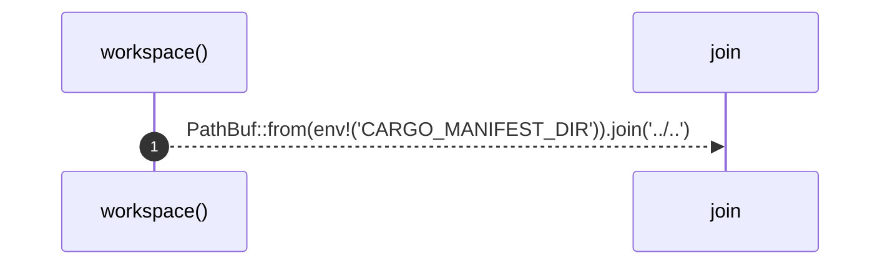

# `robby_render::test_tree::workspace`

[Self-model](../../README.md) · [test_tree](index.md)

| | |
|---|---|
| kind | `code.function` |
| signature | `fn workspace() -> PathBuf` |
| location | [`crates/robby-render/tests/tree.rs:9`](../../../../crates/robby-render/tests/tree.rs#L9) |
| provenance | extractor · confidence 1.00 |

```rust
fn workspace() -> PathBuf {
    PathBuf::from(env!("CARGO_MANIFEST_DIR")).join("../..")
}
```



1 steps · 0 observed · 1 possible only

