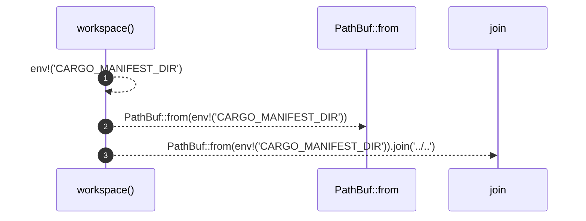

# `robby_render::test_tree::workspace`

[Self-model](../../README.md) · [test_tree](index.md)

| | |
|---|---|
| kind | `code.function` |
| signature | `fn workspace() -> PathBuf` |
| location | [`crates/robby-render/tests/tree.rs:9`](../../../../crates/robby-render/tests/tree.rs#L9) |
| provenance | extractor · confidence 1.00 |

```rust
fn workspace() -> PathBuf {
    PathBuf::from(env!("CARGO_MANIFEST_DIR")).join("../..")
}
```



3 steps · 0 observed · 3 possible only

**Edges**

- calls → [`robby_ir::kind::impl From<&str> for Kind::from`](../../robby_ir/kind/index.md)

## References

- calls → [`robby_ir::kind`](../../robby_ir/kind/index.md) — from

## Referenced by

- calls ← [`robby_render::test_tree::pages`](pages.md)
- calls ← [`robby_render::workspace_dependencies`](../workspace-dependencies.md)

