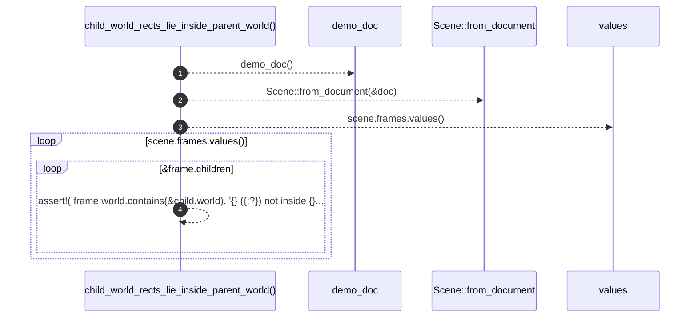

# `robby_render::test_web::child_world_rects_lie_inside_parent_world`

[Self-model](../../README.md) · [test_web](index.md)

| | |
|---|---|
| kind | `code.function` |
| signature | `fn child_world_rects_lie_inside_parent_world()` |
| location | [`crates/robby-render/tests/web.rs:172`](../../../../crates/robby-render/tests/web.rs#L172) |
| provenance | extractor · confidence 1.00 |

```rust
#[test]
fn child_world_rects_lie_inside_parent_world() {
    let (doc, _) = demo_doc();
    let scene = Scene::from_document(&doc);
    for frame in scene.frames.values() {
        for child_id in &frame.children {
            let child = &scene.frames[child_id];
            assert!(
                frame.world.contains(&child.world),
                "{} ({:?}) not inside {} ({:?})",
                child.stable_id,
                child.world,
                frame.stable_id,
                frame.world
            );
        }
    }
}
```



4 steps · 0 observed · 4 possible only

**Edges**

- calls → [`robby_render::test_web::demo_doc`](demo-doc.md)
- calls → [`robby_render::pipeline::from_document`](../pipeline/from-document.md)

## References

- calls → [`robby_render::pipeline`](../pipeline/index.md) — from_document
- calls → [`robby_render::test_web`](index.md) — demo_doc

