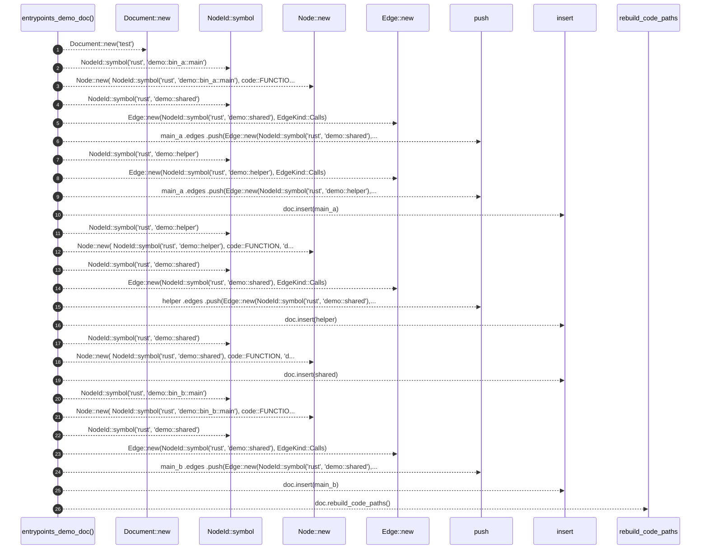

# `robby_render::test_web::entrypoints_demo_doc`

[Self-model](../../README.md) · [test_web](index.md)

| | |
|---|---|
| kind | `code.function` |
| signature | `fn entrypoints_demo_doc() -> Document` |
| location | [`crates/robby-render/tests/web.rs:88`](../../../../crates/robby-render/tests/web.rs#L88) |
| provenance | extractor · confidence 1.00 |

> Two `main` entries that both call a shared callee (first parent wins).

```rust
/// Two `main` entries that both call a shared callee (first parent wins).
fn entrypoints_demo_doc() -> Document {
    let mut doc = Document::new("test");

    let mut main_a = Node::new(
        NodeId::symbol("rust", "demo::bin_a::main"),
        code::FUNCTION,
        "demo::bin_a::main",
    );
    main_a
        .edges
        .push(Edge::new(NodeId::symbol("rust", "demo::shared"), EdgeKind::Calls));
    main_a
        .edges
        .push(Edge::new(NodeId::symbol("rust", "demo::helper"), EdgeKind::Calls));
    doc.insert(main_a);

    let mut helper = Node::new(
        NodeId::symbol("rust", "demo::helper"),
        code::FUNCTION,
        "demo::helper",
    );
    helper
        .edges
        .push(Edge::new(NodeId::symbol("rust", "demo::shared"), EdgeKind::Calls));
    doc.insert(helper);

    let shared = Node::new(
        NodeId::symbol("rust", "demo::shared"),
        code::FUNCTION,
        "demo::shared",
    );
    doc.insert(shared);

    let mut main_b = Node::new(
        NodeId::symbol("rust", "demo::bin_b::main"),
        code::FUNCTION,
        "demo::bin_b::main",
    );
    main_b
        .edges
        .push(Edge::new(NodeId::symbol("rust", "demo::shared"), EdgeKind::Calls));
    doc.insert(main_b);

    doc.rebuild_code_paths();
    doc
}
```



26 steps · 0 observed · 26 possible only

**Edges**

- calls → [`robby_render::report::impl Report::new`](../report/index.md)
- calls → [`robby_ir::model::impl NodeId::symbol`](../../robby_ir/model/index.md)
- calls → [`robby_render::report::impl Report::new`](../report/index.md)
- calls → [`robby_ir::model::impl NodeId::symbol`](../../robby_ir/model/index.md)
- calls → [`robby_render::report::impl Report::new`](../report/index.md)
- calls → [`robby_render::report::impl Report::push`](../report/index.md)
- calls → [`robby_ir::model::impl NodeId::symbol`](../../robby_ir/model/index.md)
- calls → [`robby_render::report::impl Report::new`](../report/index.md)
- calls → [`robby_render::report::impl Report::push`](../report/index.md)
- calls → [`robby_ir::model::impl Document::insert`](../../robby_ir/model/index.md)
- calls → [`robby_ir::model::impl NodeId::symbol`](../../robby_ir/model/index.md)
- calls → [`robby_render::report::impl Report::new`](../report/index.md)
- calls → [`robby_ir::model::impl NodeId::symbol`](../../robby_ir/model/index.md)
- calls → [`robby_render::report::impl Report::new`](../report/index.md)
- calls → [`robby_render::report::impl Report::push`](../report/index.md)
- calls → [`robby_ir::model::impl Document::insert`](../../robby_ir/model/index.md)
- calls → [`robby_ir::model::impl NodeId::symbol`](../../robby_ir/model/index.md)
- calls → [`robby_render::report::impl Report::new`](../report/index.md)
- calls → [`robby_ir::model::impl Document::insert`](../../robby_ir/model/index.md)
- calls → [`robby_ir::model::impl NodeId::symbol`](../../robby_ir/model/index.md)
- calls → [`robby_render::report::impl Report::new`](../report/index.md)
- calls → [`robby_ir::model::impl NodeId::symbol`](../../robby_ir/model/index.md)
- calls → [`robby_render::report::impl Report::new`](../report/index.md)
- calls → [`robby_render::report::impl Report::push`](../report/index.md)
- calls → [`robby_ir::model::impl Document::insert`](../../robby_ir/model/index.md)
- calls → [`robby_ir::model::impl Document::rebuild_code_paths`](../../robby_ir/model/index.md)

## References

- calls → [`robby_ir::model`](../../robby_ir/model/index.md) — insert, rebuild_code_paths, symbol
- calls → [`robby_render::report`](../report/index.md) — new, push

## Referenced by

- calls ← [`robby_render::test_web::entrypoints_demo_stores_code_paths_in_ir`](entrypoints-demo-stores-code-paths-in-ir.md)
- calls ← [`robby_render::test_web::entrypoints_scene_json_is_deterministic`](entrypoints-scene-json-is-deterministic.md)
- calls ← [`robby_render::test_web::entrypoints_scene_roots_mains_and_nests_callees`](entrypoints-scene-roots-mains-and-nests-callees.md)
- calls ← [`robby_render::test_web::frame_detail_includes_execution_mermaid_for_call_path`](frame-detail-includes-execution-mermaid-for-call-path.md)

