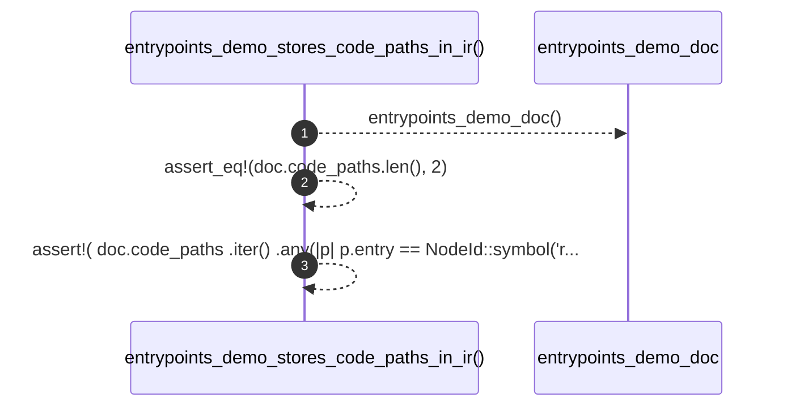

# `robby_render::test_web::entrypoints_demo_stores_code_paths_in_ir`

[Self-model](../../README.md) · [test_web](index.md)

| | |
|---|---|
| kind | `code.function` |
| signature | `fn entrypoints_demo_stores_code_paths_in_ir()` |
| location | [`crates/robby-render/tests/web.rs:328`](../../../../crates/robby-render/tests/web.rs#L328) |
| provenance | extractor · confidence 1.00 |

```rust
#[test]
fn entrypoints_demo_stores_code_paths_in_ir() {
    let doc = entrypoints_demo_doc();
    assert_eq!(doc.code_paths.len(), 2);
    assert!(
        doc.code_paths
            .iter()
            .any(|p| p.entry == NodeId::symbol("rust", "demo::bin_a::main") && !p.edges.is_empty()),
        "bin_a main should have call-tree edges"
    );
}
```



3 steps · 0 observed · 3 possible only

**Edges**

- calls → [`robby_render::test_web::entrypoints_demo_doc`](entrypoints-demo-doc.md)

## References

- calls → [`robby_render::test_web`](index.md) — entrypoints_demo_doc

