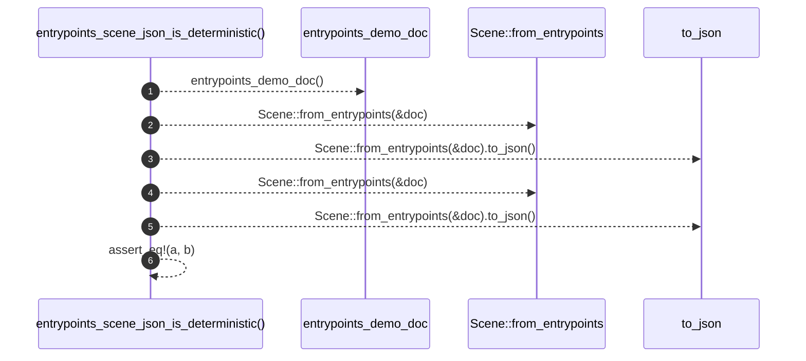

# `robby_render::test_web::entrypoints_scene_json_is_deterministic`

[Self-model](../../README.md) · [test_web](index.md)

| | |
|---|---|
| kind | `code.function` |
| signature | `fn entrypoints_scene_json_is_deterministic()` |
| location | [`crates/robby-render/tests/web.rs:385`](../../../../crates/robby-render/tests/web.rs#L385) |
| provenance | extractor · confidence 1.00 |

```rust
#[test]
fn entrypoints_scene_json_is_deterministic() {
    let doc = entrypoints_demo_doc();
    let a = Scene::from_entrypoints(&doc).to_json();
    let b = Scene::from_entrypoints(&doc).to_json();
    assert_eq!(a, b);
}
```



6 steps · 0 observed · 6 possible only

**Edges**

- calls → [`robby_render::test_web::entrypoints_demo_doc`](entrypoints-demo-doc.md)
- calls → [`robby_render::view::scene::impl Scene::from_entrypoints`](../view/scene/index.md)
- calls → [`robby_render::web::impl FrameDetail::to_json`](../web/index.md)
- calls → [`robby_render::view::scene::impl Scene::from_entrypoints`](../view/scene/index.md)
- calls → [`robby_render::web::impl FrameDetail::to_json`](../web/index.md)

## References

- calls → [`robby_render::test_web`](index.md) — entrypoints_demo_doc
- calls → [`robby_render::view::scene`](../view/scene/index.md) — from_entrypoints
- calls → [`robby_render::web`](../web/index.md) — to_json

