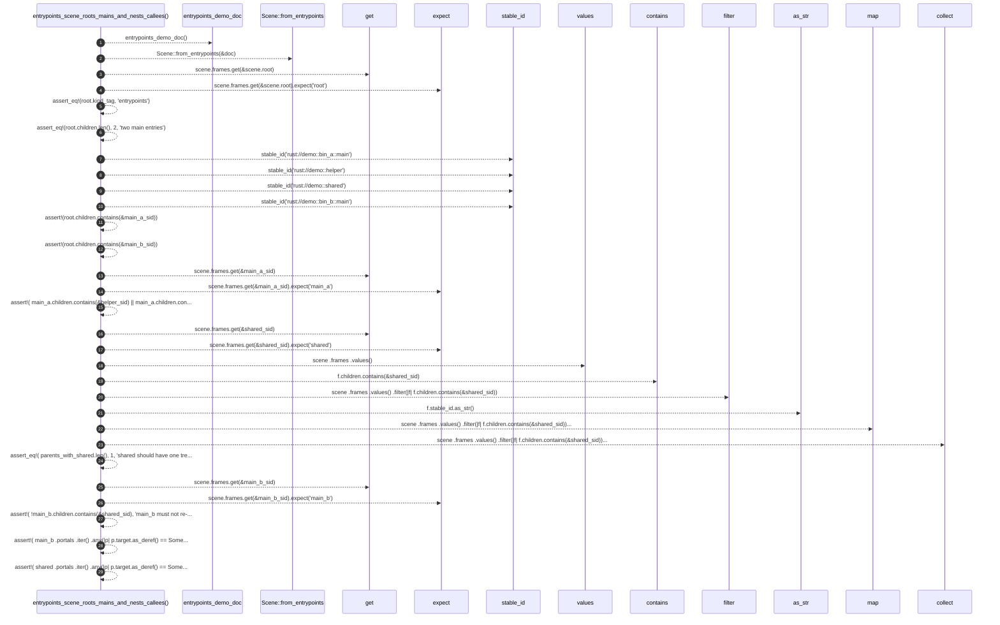

# `robby_render::test_web::entrypoints_scene_roots_mains_and_nests_callees`

[Self-model](../../README.md) · [test_web](index.md)

| | |
|---|---|
| kind | `code.function` |
| signature | `fn entrypoints_scene_roots_mains_and_nests_callees()` |
| location | [`crates/robby-render/tests/web.rs:325`](../../../../crates/robby-render/tests/web.rs#L325) |
| provenance | extractor · confidence 1.00 |

```rust
#[test]
fn entrypoints_scene_roots_mains_and_nests_callees() {
    let doc = entrypoints_demo_doc();
    let scene = Scene::from_entrypoints(&doc);
    let root = scene.frames.get(&scene.root).expect("root");
    assert_eq!(root.kind_tag, "entrypoints");
    assert_eq!(root.children.len(), 2, "two main entries");

    let main_a_sid = stable_id("rust://demo::bin_a::main");
    let helper_sid = stable_id("rust://demo::helper");
    let shared_sid = stable_id("rust://demo::shared");
    let main_b_sid = stable_id("rust://demo::bin_b::main");

    assert!(root.children.contains(&main_a_sid));
    assert!(root.children.contains(&main_b_sid));

    let main_a = scene.frames.get(&main_a_sid).expect("main_a");
    assert!(
        main_a.children.contains(&helper_sid) || main_a.children.contains(&shared_sid),
        "main_a should nest a callee, got {:?}",
        main_a.children
    );

    // Shared is placed once (first parent wins).
    let shared = scene.frames.get(&shared_sid).expect("shared");
    let parents_with_shared: Vec<_> = scene
        .frames
        .values()
        .filter(|f| f.children.contains(&shared_sid))
        .map(|f| f.stable_id.as_str())
        .collect();
    assert_eq!(
        parents_with_shared.len(),
        1,
        "shared should have one tree parent, got {parents_with_shared:?}"
    );

    // Other caller surfaces as a portal, not a second parent.
    let main_b = scene.frames.get(&main_b_sid).expect("main_b");
    assert!(
        !main_b.children.contains(&shared_sid),
        "main_b must not re-parent shared"
    );
    assert!(
        main_b
            .portals
            .iter()
            .any(|p| p.target.as_deref() == Some(shared_sid.as_str())),
        "main_b should portal to shared, got {:?}",
        main_b.portals
    );
    assert!(
        shared
            .portals
            .iter()
            .any(|p| p.target.as_deref() == Some(main_b_sid.as_str())),
        "shared should portal back to main_b"
    );
}
```



29 steps · 0 observed · 29 possible only

**Edges**

- calls → [`robby_render::test_web::entrypoints_demo_doc`](entrypoints-demo-doc.md)
- calls → [`robby_render::view::scene::impl Scene::from_entrypoints`](../view/scene/index.md)
- calls → [`robby_ir::model::impl Document::get`](../../robby_ir/model/index.md)
- calls → [`robby_render::stable_id`](../stable-id.md)
- calls → [`robby_render::stable_id`](../stable-id.md)
- calls → [`robby_render::stable_id`](../stable-id.md)
- calls → [`robby_render::stable_id`](../stable-id.md)
- calls → [`robby_ir::model::impl Document::get`](../../robby_ir/model/index.md)
- calls → [`robby_ir::model::impl Document::get`](../../robby_ir/model/index.md)
- calls → [`robby_render::view::scene::impl WorldRect::contains`](../view/scene/index.md)
- calls → [`robby_render::view::comments::impl CommentKind::as_str`](../view/comments/index.md)
- calls → [`robby_render::view::select::collect`](../view/select/collect.md)
- calls → [`robby_ir::model::impl Document::get`](../../robby_ir/model/index.md)

## References

- calls → [`robby_ir::model`](../../robby_ir/model/index.md) — get
- calls → [`robby_render`](../index.md) — stable_id
- calls → [`robby_render::test_web`](index.md) — entrypoints_demo_doc
- calls → [`robby_render::view::comments`](../view/comments/index.md) — as_str
- calls → [`robby_render::view::scene`](../view/scene/index.md) — contains, from_entrypoints
- calls → [`robby_render::view::select`](../view/select/index.md) — collect

