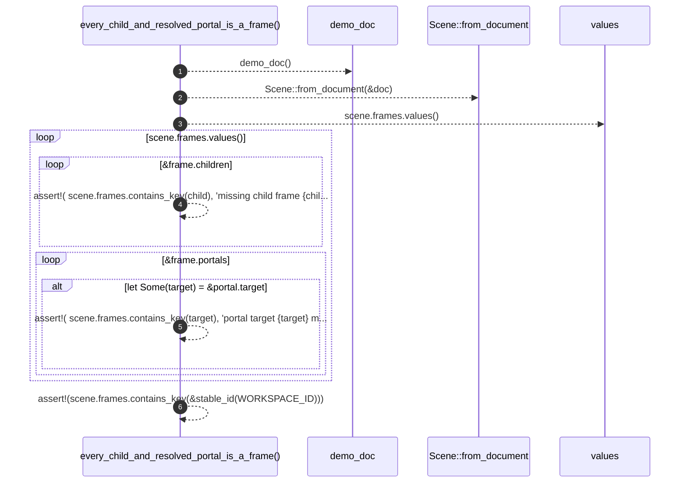

# `robby_render::test_web::every_child_and_resolved_portal_is_a_frame`

[Self-model](../../README.md) · [test_web](index.md)

| | |
|---|---|
| kind | `code.function` |
| signature | `fn every_child_and_resolved_portal_is_a_frame()` |
| location | [`crates/robby-render/tests/web.rs:149`](../../../../crates/robby-render/tests/web.rs#L149) |
| provenance | extractor · confidence 1.00 |

```rust
#[test]
fn every_child_and_resolved_portal_is_a_frame() {
    let (doc, _) = demo_doc();
    let scene = Scene::from_document(&doc);
    for frame in scene.frames.values() {
        for child in &frame.children {
            assert!(
                scene.frames.contains_key(child),
                "missing child frame {child}"
            );
        }
        for portal in &frame.portals {
            if let Some(target) = &portal.target {
                assert!(
                    scene.frames.contains_key(target),
                    "portal target {target} missing from scene"
                );
            }
        }
    }
    assert!(scene.frames.contains_key(&stable_id(WORKSPACE_ID)));
}
```



6 steps · 0 observed · 6 possible only

**Edges**

- calls → [`robby_render::test_web::demo_doc`](demo-doc.md)
- calls → [`robby_render::pipeline::from_document`](../pipeline/from-document.md)

## References

- calls → [`robby_render::pipeline`](../pipeline/index.md) — from_document
- calls → [`robby_render::test_web`](index.md) — demo_doc

