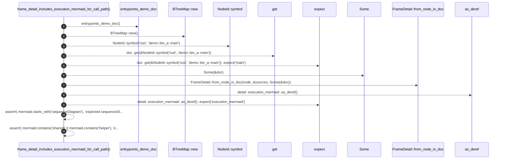

# `robby_render::test_web::frame_detail_includes_execution_mermaid_for_call_path`

[Self-model](../../README.md) · [test_web](index.md)

| | |
|---|---|
| kind | `code.function` |
| signature | `fn frame_detail_includes_execution_mermaid_for_call_path()` |
| location | [`crates/robby-render/tests/web.rs:303`](../../../../crates/robby-render/tests/web.rs#L303) |
| provenance | extractor · confidence 1.00 |

```rust
#[test]
fn frame_detail_includes_execution_mermaid_for_call_path() {
    let doc = entrypoints_demo_doc();
    let sources = BTreeMap::new();
    let node = doc
        .get(&NodeId::symbol("rust", "demo::bin_a::main"))
        .expect("main");
    let detail = FrameDetail::from_node_in_doc(node, &sources, Some(&doc));
    let mermaid = detail
        .execution_mermaid
        .as_deref()
        .expect("execution_mermaid");
    assert!(
        mermaid.starts_with("sequenceDiagram"),
        "expected sequenceDiagram, got {mermaid:?}"
    );
    assert!(
        mermaid.contains("shared") || mermaid.contains("helper"),
        "expected callees in diagram: {mermaid}"
    );
}
```



11 steps · 0 observed · 11 possible only

**Edges**

- calls → [`robby_render::test_web::entrypoints_demo_doc`](entrypoints-demo-doc.md)
- calls → [`robby_render::report::impl Report::new`](../report/index.md)
- calls → [`robby_ir::model::impl NodeId::symbol`](../../robby_ir/model/index.md)
- calls → [`robby_ir::model::impl Document::get`](../../robby_ir/model/index.md)
- calls → [`robby_render::web::impl FrameDetail::from_node_in_doc`](../web/index.md)

## References

- calls → [`robby_ir::model`](../../robby_ir/model/index.md) — get, symbol
- calls → [`robby_render::report`](../report/index.md) — new
- calls → [`robby_render::test_web`](index.md) — entrypoints_demo_doc
- calls → [`robby_render::web`](../web/index.md) — from_node_in_doc

