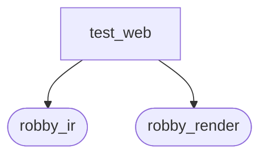

# `robby_render::test_web`

[Self-model](../../README.md) · [robby_render](../index.md)

| | |
|---|---|
| kind | `code.module` |
| provenance | extractor · confidence 1.00 |
| nodes | 21 |

## Package diagram



## Module coupling

```mermaid
flowchart TB
    subgraph n_310d14cf579135a7["test_web"]
        direction TB
        n_6c39fec40a174770["child_world_rects_lie_inside_parent_world"]
        n_5d64ffe3865383a1["demo_doc"]
        n_5d18d5212c5cf3a9["entrypoints_demo_doc"]
        n_7f6f7186631adb12["entrypoints_demo_stores_code_paths_in_ir"]
        n_8a5da80d612a110c["entrypoints_scene_json_is_deterministic"]
        n_0ccee746718d0bcc["entrypoints_scene_roots_mains_and_nests_callees"]
        n_a38744c649815c94["every_child_and_resolved_portal_is_a_frame"]
        n_ce2aa79a890e3168["frame_detail_includes_execution_mermaid_for_call_path"]
        n_ccc4db85332b95a2["leaf_payload_includes_source_and_process"]
        n_0572a55b97877ef3["scene_json_is_byte_identical_across_runs"]
        n_9ca9be67b573c9bf["sibling_local_rects_do_not_overlap"]
        n_eff1ef85ab0370f2["sibling_world_rects_do_not_collapse_onto_each_other"]
        n_707a7b55bf4d7e1f["tempfile_dir"]
        n_cc261f5078ecd444["unresolved_portal_has_no_zoom_target"]
        n_a7f44ae87911cf31["write_site_emits_scene_and_frames"]
    end
    n_0572a55b97877ef3 --> n_5d64ffe3865383a1
    n_0ccee746718d0bcc --> n_5d18d5212c5cf3a9
    n_6c39fec40a174770 --> n_5d64ffe3865383a1
    n_7f6f7186631adb12 --> n_5d18d5212c5cf3a9
    n_8a5da80d612a110c --> n_5d18d5212c5cf3a9
    n_9ca9be67b573c9bf --> n_5d64ffe3865383a1
    n_a38744c649815c94 --> n_5d64ffe3865383a1
    n_a7f44ae87911cf31 --> n_5d64ffe3865383a1
    n_a7f44ae87911cf31 --> n_707a7b55bf4d7e1f
    n_cc261f5078ecd444 --> n_5d64ffe3865383a1
    n_ccc4db85332b95a2 --> n_5d64ffe3865383a1
    n_ce2aa79a890e3168 --> n_5d18d5212c5cf3a9
    n_eff1ef85ab0370f2 --> n_5d64ffe3865383a1
```



## Dependency matrix

| | test_web | robby_ir | robby_render |
|---|---:|---:|---:|
| **test_web** | · | 43 | 56 |
| **robby_ir** | | · | |
| **robby_render** | | | · |

## Comments

- `crates/robby-render/tests/web.rs:89:1` (docs, `robby_render::test_web::entrypoints_demo_doc`): "Two `main` entries that both call a shared callee (first parent wins)."
  ```
  /// Two `main` entries that both call a shared callee (first parent wins).
  fn entrypoints_demo_doc() -> Document {
      let mut doc = Document::new("test");
  
      let mut main_a = Node::new(
          NodeId::symbol("rust", "demo::bin_a::main"),
          code::FUNCTION,
          "demo::bin_a::main",
      );
      main_a.edges.push(Edge::new(
          NodeId::symbol("rust", "demo::shared"),
          EdgeKind::Calls,
      ));
      main_a.edges.push(Edge::new(
          NodeId::symbol("rust", "demo::helper"),
          EdgeKind::Calls,
      ));
      doc.insert(main_a);
  
      let mut helper = Node::new(
          NodeId::symbol("rust", "demo::helper"),
          code::FUNCTION,
          "demo::helper",
      );
      helper.edges.push(Edge::new(
          NodeId::symbol("rust", "demo::shared"),
          EdgeKind::Calls,
      ));
      doc.insert(helper);
  
      let shared = Node::new(
          NodeId::symbol("rust", "demo::shared"),
          code::FUNCTION,
          "demo::shared",
      );
      doc.insert(shared);
  
      let mut main_b = Node::new(
          NodeId::symbol("rust", "demo::bin_b::main"),
          code::FUNCTION,
          "demo::bin_b::main",
      );
      main_b.edges.push(Edge::new(
          NodeId::symbol("rust", "demo::shared"),
          EdgeKind::Calls,
      ));
      doc.insert(main_b);
  
      doc.rebuild_code_paths();
      doc
  }
  ```
## References

- calls → [`robby_ir::kind`](../../robby_ir/kind/index.md) — from
- calls → [`robby_ir::model`](../../robby_ir/model/index.md) — get, insert, rebuild_code_paths, symbol
- calls → [`robby_ir::process`](../../robby_ir/process/index.md) — participant
- calls → [`robby_render`](../index.md) — stable_id
- calls → [`robby_render::pipeline`](../pipeline/index.md) — from_document
- calls → [`robby_render::report`](../report/index.md) — new, push
- calls → [`robby_render::test_render`](../test_render/index.md) — step
- calls → [`robby_render::view::comments`](../view/comments/index.md) — as_str
- calls → [`robby_render::view::scene`](../view/scene/index.md) — contains, from_entrypoints
- calls → [`robby_render::view::select`](../view/select/index.md) — collect
- calls → [`robby_render::web`](../web/index.md) — from_node, from_node_in_doc, to_json, write_site

## Items

| Item | Kind | Steps | Location |
|---|---|---:|---|
| [`demo_doc`](demo-doc.md) | `code.function` | 54 | `crates/robby-render/tests/web.rs:10:1` |
| [`entrypoints_demo_doc`](entrypoints-demo-doc.md) | `code.function` | 26 | `crates/robby-render/tests/web.rs:89:1` |
| [`scene_json_is_byte_identical_across_runs`](scene-json-is-byte-identical-across-runs.md) | `code.function` | 6 | `crates/robby-render/tests/web.rs:141:1` |
| [`every_child_and_resolved_portal_is_a_frame`](every-child-and-resolved-portal-is-a-frame.md) | `code.function` | 6 | `crates/robby-render/tests/web.rs:149:1` |
| [`child_world_rects_lie_inside_parent_world`](child-world-rects-lie-inside-parent-world.md) | `code.function` | 4 | `crates/robby-render/tests/web.rs:172:1` |
| [`sibling_local_rects_do_not_overlap`](sibling-local-rects-do-not-overlap.md) | `code.function` | 11 | `crates/robby-render/tests/web.rs:191:1` |
| [`sibling_world_rects_do_not_collapse_onto_each_other`](sibling-world-rects-do-not-collapse-onto-each-other.md) | `code.function` | 15 | `crates/robby-render/tests/web.rs:218:1` |
| [`leaf_payload_includes_source_and_process`](leaf-payload-includes-source-and-process.md) | `code.function` | 11 | `crates/robby-render/tests/web.rs:244:1` |
| [`unresolved_portal_has_no_zoom_target`](unresolved-portal-has-no-zoom-target.md) | `code.function` | 10 | `crates/robby-render/tests/web.rs:259:1` |
| [`write_site_emits_scene_and_frames`](write-site-emits-scene-and-frames.md) | `code.function` | 12 | `crates/robby-render/tests/web.rs:276:1` |
| [`entrypoints_demo_stores_code_paths_in_ir`](entrypoints-demo-stores-code-paths-in-ir.md) | `code.function` | 3 | `crates/robby-render/tests/web.rs:291:1` |
| [`frame_detail_includes_execution_mermaid_for_call_path`](frame-detail-includes-execution-mermaid-for-call-path.md) | `code.function` | 11 | `crates/robby-render/tests/web.rs:303:1` |
| [`entrypoints_scene_roots_mains_and_nests_callees`](entrypoints-scene-roots-mains-and-nests-callees.md) | `code.function` | 29 | `crates/robby-render/tests/web.rs:325:1` |
| [`entrypoints_scene_json_is_deterministic`](entrypoints-scene-json-is-deterministic.md) | `code.function` | 6 | `crates/robby-render/tests/web.rs:385:1` |
| [`tempfile_dir`](tempfile-dir.md) | `code.function` | 5 | `crates/robby-render/tests/web.rs:393:1` |

## Imports

- `use std::collections::BTreeMap;`
- [`use robby_ir::kind::code;`](../../robby_ir/kind/code/index.md)
- [`use robby_ir::{Document, Edge, EdgeKind, Kind, Node, NodeId, Process, Span, Step, StepKind};`](../../robby_ir/index.md)
- [`use robby_render::view::{Scene, WORKSPACE_ID};`](../view/index.md)
- [`use robby_render::{FrameDetail, stable_id, write_site};`](../index.md)

