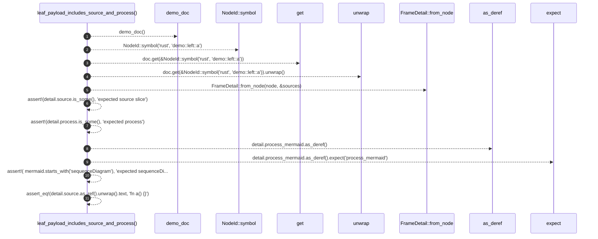

# `robby_render::test_web::leaf_payload_includes_source_and_process`

[Self-model](../../README.md) · [test_web](index.md)

| | |
|---|---|
| kind | `code.function` |
| signature | `fn leaf_payload_includes_source_and_process()` |
| location | [`crates/robby-render/tests/web.rs:239`](../../../../crates/robby-render/tests/web.rs#L239) |
| provenance | extractor · confidence 1.00 |

```rust
#[test]
fn leaf_payload_includes_source_and_process() {
    let (doc, sources) = demo_doc();
    let node = doc.get(&NodeId::symbol("rust", "demo::left::a")).unwrap();
    let detail = FrameDetail::from_node(node, &sources);
    assert!(detail.source.is_some(), "expected source slice");
    assert!(detail.process.is_some(), "expected process");
    let mermaid = detail.process_mermaid.as_deref().expect("process_mermaid");
    assert!(
        mermaid.starts_with("sequenceDiagram"),
        "expected sequenceDiagram, got {mermaid:?}"
    );
    assert_eq!(detail.source.as_ref().unwrap().text, "fn a() {}");
}
```



11 steps · 0 observed · 11 possible only

**Edges**

- calls → [`robby_render::test_web::demo_doc`](demo-doc.md)
- calls → [`robby_ir::model::impl NodeId::symbol`](../../robby_ir/model/index.md)
- calls → [`robby_ir::model::impl Document::get`](../../robby_ir/model/index.md)
- calls → [`robby_render::web::impl FrameDetail::from_node`](../web/index.md)

## References

- calls → [`robby_ir::model`](../../robby_ir/model/index.md) — get, symbol
- calls → [`robby_render::test_web`](index.md) — demo_doc
- calls → [`robby_render::web`](../web/index.md) — from_node

