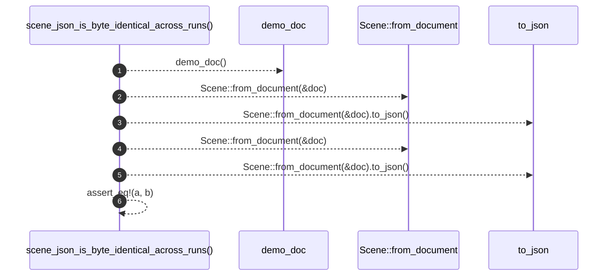

# `robby_render::test_web::scene_json_is_byte_identical_across_runs`

[Self-model](../../README.md) · [test_web](index.md)

| | |
|---|---|
| kind | `code.function` |
| signature | `fn scene_json_is_byte_identical_across_runs()` |
| location | [`crates/robby-render/tests/web.rs:141`](../../../../crates/robby-render/tests/web.rs#L141) |
| provenance | extractor · confidence 1.00 |

```rust
#[test]
fn scene_json_is_byte_identical_across_runs() {
    let (doc, _) = demo_doc();
    let a = Scene::from_document(&doc).to_json();
    let b = Scene::from_document(&doc).to_json();
    assert_eq!(a, b);
}
```



6 steps · 0 observed · 6 possible only

**Edges**

- calls → [`robby_render::test_web::demo_doc`](demo-doc.md)
- calls → [`robby_render::pipeline::from_document`](../pipeline/from-document.md)
- calls → [`robby_render::runs::impl RunRecord::to_json`](../runs/index.md)
- calls → [`robby_render::pipeline::from_document`](../pipeline/from-document.md)
- calls → [`robby_render::runs::impl RunRecord::to_json`](../runs/index.md)

## References

- calls → [`robby_render::pipeline`](../pipeline/index.md) — from_document
- calls → [`robby_render::runs`](../runs/index.md) — to_json
- calls → [`robby_render::test_web`](index.md) — demo_doc

