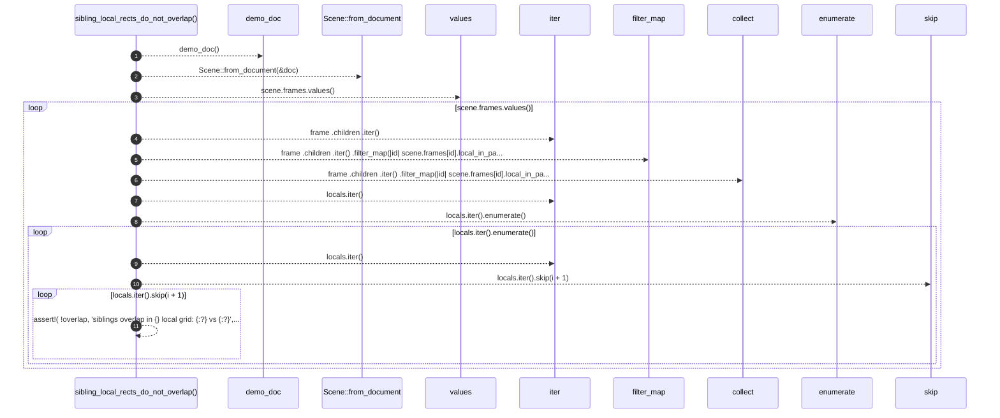

# `robby_render::test_web::sibling_local_rects_do_not_overlap`

[Self-model](../../README.md) · [test_web](index.md)

| | |
|---|---|
| kind | `code.function` |
| signature | `fn sibling_local_rects_do_not_overlap()` |
| location | [`crates/robby-render/tests/web.rs:186`](../../../../crates/robby-render/tests/web.rs#L186) |
| provenance | extractor · confidence 1.00 |

```rust
#[test]
fn sibling_local_rects_do_not_overlap() {
    let (doc, _) = demo_doc();
    let scene = Scene::from_document(&doc);
    for frame in scene.frames.values() {
        let locals: Vec<_> = frame
            .children
            .iter()
            .filter_map(|id| scene.frames[id].local_in_parent)
            .collect();
        for (i, a) in locals.iter().enumerate() {
            for b in locals.iter().skip(i + 1) {
                let ax2 = a.x + a.w;
                let ay2 = a.y + a.h;
                let bx2 = b.x + b.w;
                let by2 = b.y + b.h;
                let overlap = !(ax2 <= b.x || bx2 <= a.x || ay2 <= b.y || by2 <= a.y);
                assert!(
                    !overlap,
                    "siblings overlap in {} local grid: {:?} vs {:?}",
                    frame.fqn, a, b
                );
            }
        }
    }
}
```



11 steps · 0 observed · 11 possible only

**Edges**

- calls → [`robby_render::test_web::demo_doc`](demo-doc.md)
- calls → [`robby_render::pipeline::from_document`](../pipeline/from-document.md)
- calls → [`robby_render::view::select::collect`](../view/select/collect.md)

## References

- calls → [`robby_render::pipeline`](../pipeline/index.md) — from_document
- calls → [`robby_render::test_web`](index.md) — demo_doc
- calls → [`robby_render::view::select`](../view/select/index.md) — collect

