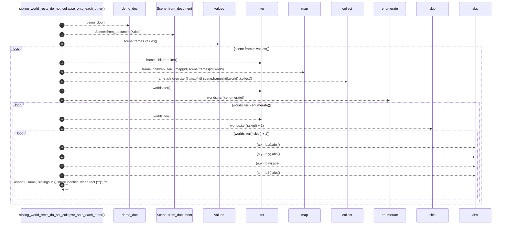

# `robby_render::test_web::sibling_world_rects_do_not_collapse_onto_each_other`

[Self-model](../../README.md) · [test_web](index.md)

| | |
|---|---|
| kind | `code.function` |
| signature | `fn sibling_world_rects_do_not_collapse_onto_each_other()` |
| location | [`crates/robby-render/tests/web.rs:218`](../../../../crates/robby-render/tests/web.rs#L218) |
| provenance | extractor · confidence 1.00 |

```rust
#[test]
fn sibling_world_rects_do_not_collapse_onto_each_other() {
    let (doc, _) = demo_doc();
    let scene = Scene::from_document(&doc);
    for frame in scene.frames.values() {
        let worlds: Vec<_> = frame
            .children
            .iter()
            .map(|id| scene.frames[id].world)
            .collect();
        for (i, a) in worlds.iter().enumerate() {
            for b in worlds.iter().skip(i + 1) {
                let same = (a.x - b.x).abs() < 1e-9
                    && (a.y - b.y).abs() < 1e-9
                    && (a.w - b.w).abs() < 1e-9
                    && (a.h - b.h).abs() < 1e-9;
                assert!(
                    !same,
                    "siblings in {} share identical world rect {:?}",
                    frame.fqn, a
                );
            }
        }
    }
}
```



15 steps · 0 observed · 15 possible only

**Edges**

- calls → [`robby_render::test_web::demo_doc`](demo-doc.md)
- calls → [`robby_render::pipeline::from_document`](../pipeline/from-document.md)
- calls → [`robby_render::view::select::collect`](../view/select/collect.md)

## References

- calls → [`robby_render::pipeline`](../pipeline/index.md) — from_document
- calls → [`robby_render::test_web`](index.md) — demo_doc
- calls → [`robby_render::view::select`](../view/select/index.md) — collect

