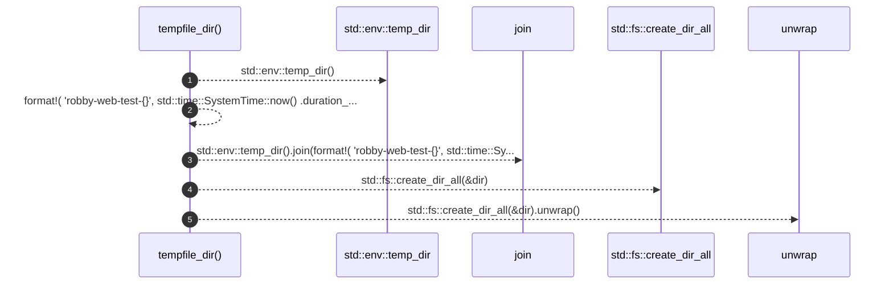

# `robby_render::test_web::tempfile_dir`

[Self-model](../../README.md) · [test_web](index.md)

| | |
|---|---|
| kind | `code.function` |
| signature | `fn tempfile_dir() -> std::path::PathBuf` |
| location | [`crates/robby-render/tests/web.rs:393`](../../../../crates/robby-render/tests/web.rs#L393) |
| provenance | extractor · confidence 1.00 |

```rust
fn tempfile_dir() -> std::path::PathBuf {
    let dir = std::env::temp_dir().join(format!(
        "robby-web-test-{}",
        std::time::SystemTime::now()
            .duration_since(std::time::UNIX_EPOCH)
            .unwrap()
            .as_nanos()
    ));
    std::fs::create_dir_all(&dir).unwrap();
    dir
}
```



5 steps · 0 observed · 5 possible only

## Referenced by

- calls ← [`robby_render::test_web::write_site_emits_scene_and_frames`](write-site-emits-scene-and-frames.md)

