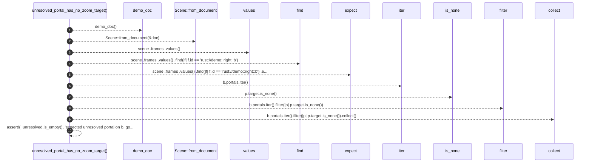

# `robby_render::test_web::unresolved_portal_has_no_zoom_target`

[Self-model](../../README.md) · [test_web](index.md)

| | |
|---|---|
| kind | `code.function` |
| signature | `fn unresolved_portal_has_no_zoom_target()` |
| location | [`crates/robby-render/tests/web.rs:259`](../../../../crates/robby-render/tests/web.rs#L259) |
| provenance | extractor · confidence 1.00 |

```rust
#[test]
fn unresolved_portal_has_no_zoom_target() {
    let (doc, _) = demo_doc();
    let scene = Scene::from_document(&doc);
    let b = scene
        .frames
        .values()
        .find(|f| f.id == "rust://demo::right::b")
        .expect("function b frame");
    let unresolved: Vec<_> = b.portals.iter().filter(|p| p.target.is_none()).collect();
    assert!(
        !unresolved.is_empty(),
        "expected unresolved portal on b, got {:?}",
        b.portals
    );
}
```



10 steps · 0 observed · 10 possible only

**Edges**

- calls → [`robby_render::test_web::demo_doc`](demo-doc.md)
- calls → [`robby_render::pipeline::from_document`](../pipeline/from-document.md)
- calls → [`robby_render::view::select::collect`](../view/select/collect.md)

## References

- calls → [`robby_render::pipeline`](../pipeline/index.md) — from_document
- calls → [`robby_render::test_web`](index.md) — demo_doc
- calls → [`robby_render::view::select`](../view/select/index.md) — collect

