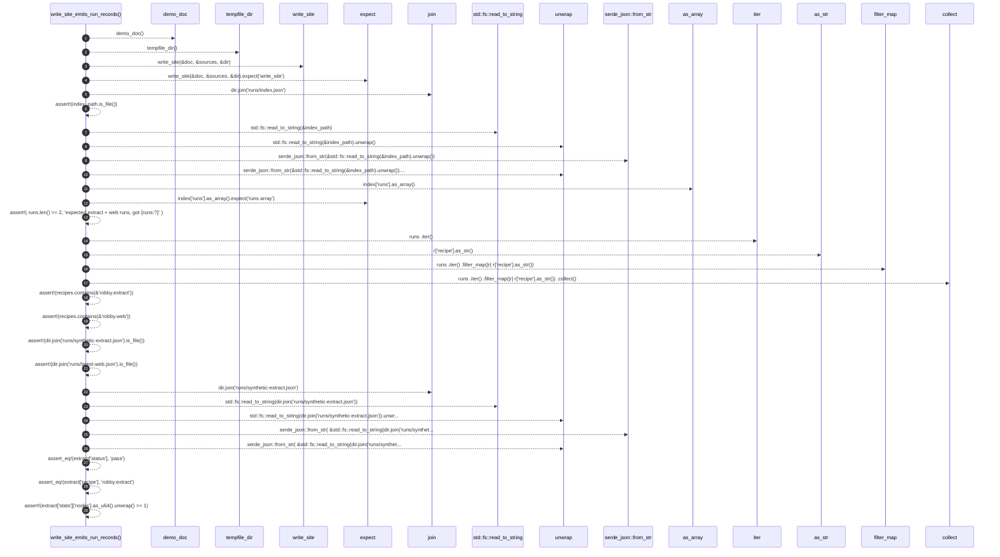

# `robby_render::test_web::write_site_emits_run_records`

[Self-model](../../README.md) · [test_web](index.md)

| | |
|---|---|
| kind | `code.function` |
| signature | `fn write_site_emits_run_records()` |
| location | [`crates/robby-render/tests/web.rs:292`](../../../../crates/robby-render/tests/web.rs#L292) |
| provenance | extractor · confidence 1.00 |

```rust
#[test]
fn write_site_emits_run_records() {
    let (doc, sources) = demo_doc();
    let dir = tempfile_dir();
    write_site(&doc, &sources, &dir).expect("write_site");
    let index_path = dir.join("runs/index.json");
    assert!(index_path.is_file());
    let index: serde_json::Value =
        serde_json::from_str(&std::fs::read_to_string(&index_path).unwrap()).unwrap();
    let runs = index["runs"].as_array().expect("runs array");
    assert!(
        runs.len() >= 2,
        "expected extract + web runs, got {runs:?}"
    );
    let recipes: Vec<_> = runs
        .iter()
        .filter_map(|r| r["recipe"].as_str())
        .collect();
    assert!(recipes.contains(&"robby.extract"));
    assert!(recipes.contains(&"robby.web"));
    assert!(dir.join("runs/synthetic-extract.json").is_file());
    assert!(dir.join("runs/latest-web.json").is_file());
    let extract: serde_json::Value = serde_json::from_str(
        &std::fs::read_to_string(dir.join("runs/synthetic-extract.json")).unwrap(),
    )
    .unwrap();
    assert_eq!(extract["status"], "pass");
    assert_eq!(extract["recipe"], "robby.extract");
    assert!(extract["stats"]["nodes"].as_u64().unwrap() >= 1);
}
```



29 steps · 0 observed · 29 possible only

**Edges**

- calls → [`robby_render::test_web::demo_doc`](demo-doc.md)
- calls → [`robby_render::test_web::tempfile_dir`](tempfile-dir.md)
- calls → [`robby_render::web::write_site`](../web/write-site.md)
- calls → [`robby_render::view::comments::impl NoteKind::as_str`](../view/comments/index.md)
- calls → [`robby_render::view::select::collect`](../view/select/collect.md)

## References

- calls → [`robby_render::test_web`](index.md) — demo_doc, tempfile_dir
- calls → [`robby_render::view::comments`](../view/comments/index.md) — as_str
- calls → [`robby_render::view::select`](../view/select/index.md) — collect
- calls → [`robby_render::web`](../web/index.md) — write_site

