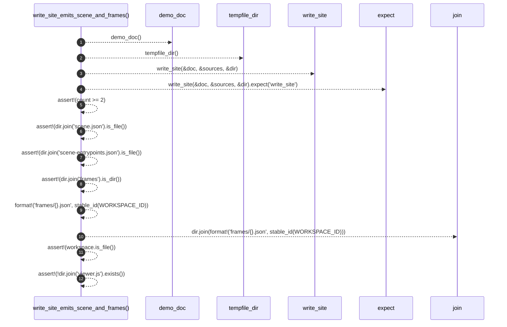

# `robby_render::test_web::write_site_emits_scene_and_frames`

[Self-model](../../README.md) · [test_web](index.md)

| | |
|---|---|
| kind | `code.function` |
| signature | `fn write_site_emits_scene_and_frames()` |
| location | [`crates/robby-render/tests/web.rs:276`](../../../../crates/robby-render/tests/web.rs#L276) |
| provenance | extractor · confidence 1.00 |

```rust
#[test]
fn write_site_emits_scene_and_frames() {
    let (doc, sources) = demo_doc();
    let dir = tempfile_dir();
    let count = write_site(&doc, &sources, &dir).expect("write_site");
    assert!(count >= 2);
    assert!(dir.join("scene.json").is_file());
    assert!(dir.join("scene-entrypoints.json").is_file());
    assert!(dir.join("frames").is_dir());
    let workspace = dir.join(format!("frames/{}.json", stable_id(WORKSPACE_ID)));
    assert!(workspace.is_file());
    // No JavaScript in the site data output.
    assert!(!dir.join("viewer.js").exists());
}
```



12 steps · 0 observed · 12 possible only

**Edges**

- calls → [`robby_render::test_web::demo_doc`](demo-doc.md)
- calls → [`robby_render::test_web::tempfile_dir`](tempfile-dir.md)
- calls → [`robby_render::web::write_site`](../web/write-site.md)

## References

- calls → [`robby_render::test_web`](index.md) — demo_doc, tempfile_dir
- calls → [`robby_render::web`](../web/index.md) — write_site

