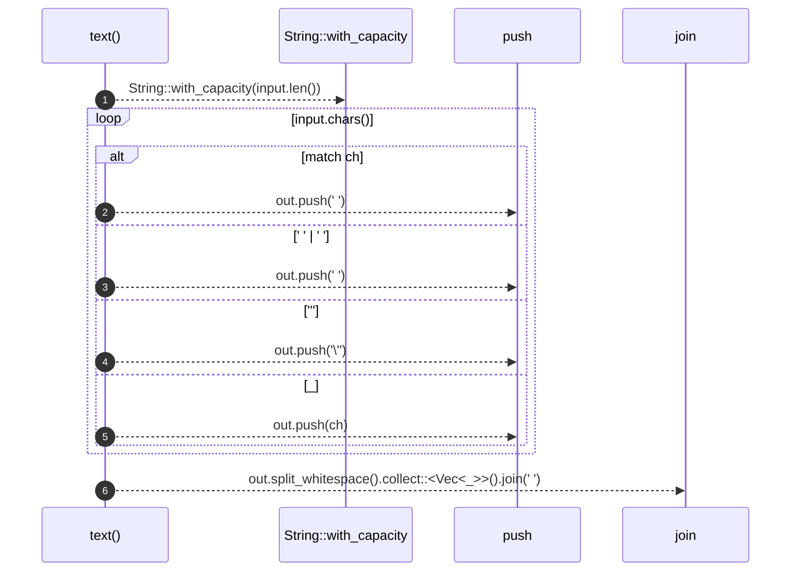

# `robby_render::text`

[Self-model](../README.md) · [robby_render](index.md)

| | |
|---|---|
| kind | `code.function` |
| signature | `fn text(input: &str) -> String` |
| location | [`crates/robby-render/src/lib.rs:231`](../../../crates/robby-render/src/lib.rs#L231) |
| provenance | extractor · confidence 1.00 |

> Sanitize text for a Mermaid label or message.

```rust
/// Sanitize text for a Mermaid label or message.
fn text(input: &str) -> String {
    let mut out = String::with_capacity(input.len());
    for ch in input.chars() {
        match ch {
            '\n' | '\r' | '\t' => out.push(' '),
            ';' | '#' => out.push(' '),
            '"' => out.push('\''),
            _ => out.push(ch),
        }
    }
    out.split_whitespace().collect::<Vec<_>>().join(" ")
}
```



6 steps · 0 observed · 6 possible only

