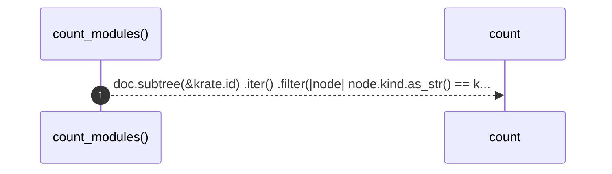

# `robby_render::tree::count_modules`

[Self-model](../../README.md) · [tree](index.md)

| | |
|---|---|
| kind | `code.function` |
| signature | `fn count_modules(doc: &Document, krate: &Node) -> usize` |
| location | [`crates/robby-render/src/tree.rs:634`](../../../../crates/robby-render/src/tree.rs#L634) |
| provenance | extractor · confidence 1.00 |

```rust
fn count_modules(doc: &Document, krate: &Node) -> usize {
    doc.subtree(&krate.id)
        .iter()
        .filter(|node| node.kind.as_str() == kind::code::MODULE)
        .count()
}
```



1 steps · 0 observed · 1 possible only

