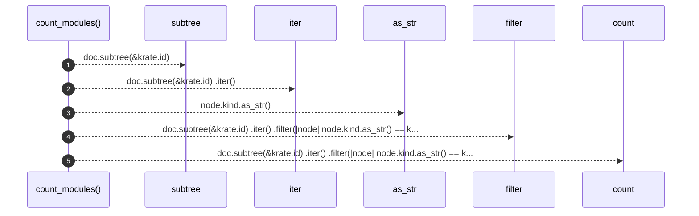

# `robby_render::tree::count_modules`

[Self-model](../../README.md) · [tree](index.md)

| | |
|---|---|
| kind | `code.function` |
| signature | `fn count_modules(doc: &Document, krate: &Node) -> usize` |
| location | [`crates/robby-render/src/tree.rs:813`](../../../../crates/robby-render/src/tree.rs#L813) |
| provenance | extractor · confidence 1.00 |

```rust
fn count_modules(doc: &Document, krate: &Node) -> usize {
    doc.subtree(&krate.id)
        .iter()
        .filter(|node| node.kind.as_str() == kind::code::MODULE)
        .count()
}
```



5 steps · 0 observed · 5 possible only

**Edges**

- calls → [`robby_ir::model::impl Document::subtree`](../../robby_ir/model/index.md)
- calls → [`robby_render::view::comments::impl NoteKind::as_str`](../view/comments/index.md)

## References

- calls → [`robby_ir::model`](../../robby_ir/model/index.md) — subtree
- calls → [`robby_render::view::comments`](../view/comments/index.md) — as_str

