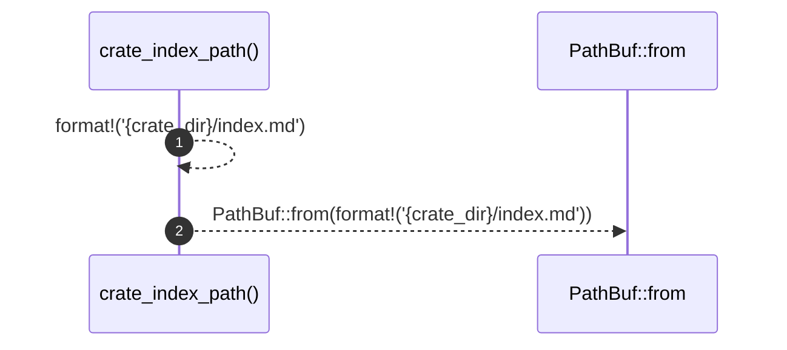

# `robby_render::tree::crate_index_path`

[Self-model](../../README.md) · [tree](index.md)

| | |
|---|---|
| kind | `code.function` |
| signature | `fn crate_index_path(crate_dir: &str) -> PathBuf` |
| location | [`crates/robby-render/src/tree.rs:704`](../../../../crates/robby-render/src/tree.rs#L704) |
| provenance | extractor · confidence 1.00 |

```rust
fn crate_index_path(crate_dir: &str) -> PathBuf {
    PathBuf::from(format!("{crate_dir}/index.md"))
}
```



2 steps · 0 observed · 2 possible only

**Edges**

- calls → [`robby_ir::kind::impl From<&str> for Kind::from`](../../robby_ir/kind/index.md)

## References

- calls → [`robby_ir::kind`](../../robby_ir/kind/index.md) — from

## Referenced by

- calls ← [`robby_render::tree::module_index_path`](module-index-path.md)
- calls ← [`robby_render::tree::nav`](nav.md)

