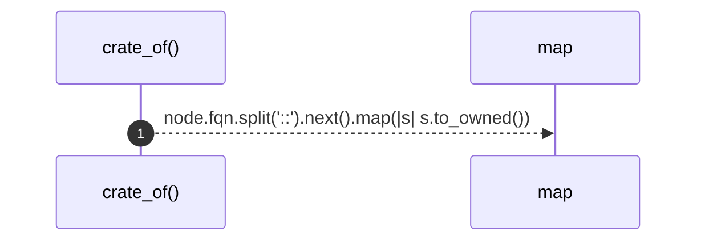

# `robby_render::tree::crate_of`

[Self-model](../../README.md) · [tree](index.md)

| | |
|---|---|
| kind | `code.function` |
| signature | `fn crate_of(node: &Node) -> Option<String>` |
| location | [`crates/robby-render/src/tree.rs:512`](../../../../crates/robby-render/src/tree.rs#L512) |
| provenance | extractor · confidence 1.00 |

```rust
fn crate_of(node: &Node) -> Option<String> {
    node.fqn.split("::").next().map(|s| s.to_owned())
}
```



1 steps · 0 observed · 1 possible only

