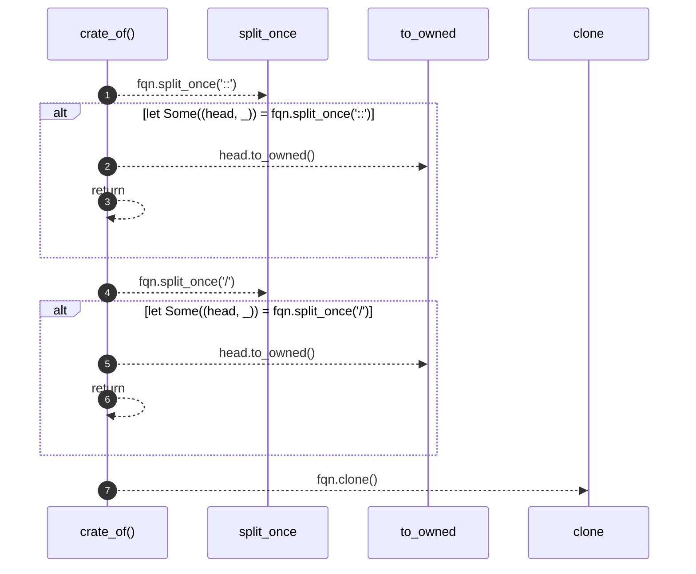

# `robby_render::tree::crate_of`

[Self-model](../../README.md) · [tree](index.md)

| | |
|---|---|
| kind | `code.function` |
| signature | `fn crate_of(node: &Node) -> String` |
| location | [`crates/robby-render/src/tree.rs:670`](../../../../crates/robby-render/src/tree.rs#L670) |
| provenance | extractor · confidence 1.00 |

```rust
fn crate_of(node: &Node) -> String {
    // Rust FQNs use `::`; TypeScript packages use `/` after the package name.
    let fqn = &node.fqn;
    if let Some((head, _)) = fqn.split_once("::") {
        return head.to_owned();
    }
    if let Some((head, _)) = fqn.split_once('/') {
        return head.to_owned();
    }
    fqn.clone()
}
```



7 steps · 0 observed · 7 possible only

## Referenced by

- calls ← [`robby_render::tree::nav`](nav.md)
- calls ← [`robby_render::tree::page_of_node`](page-of-node.md)

