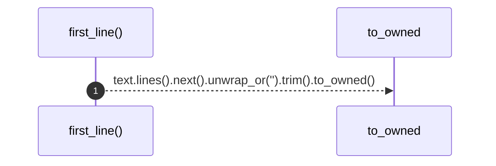

# `robby_render::tree::first_line`

[Self-model](../../README.md) · [tree](index.md)

| | |
|---|---|
| kind | `code.function` |
| signature | `fn first_line(text: &str) -> String` |
| location | [`crates/robby-render/src/tree.rs:630`](../../../../crates/robby-render/src/tree.rs#L630) |
| provenance | extractor · confidence 1.00 |

```rust
fn first_line(text: &str) -> String {
    text.lines().next().unwrap_or("").trim().to_owned()
}
```



1 steps · 0 observed · 1 possible only

