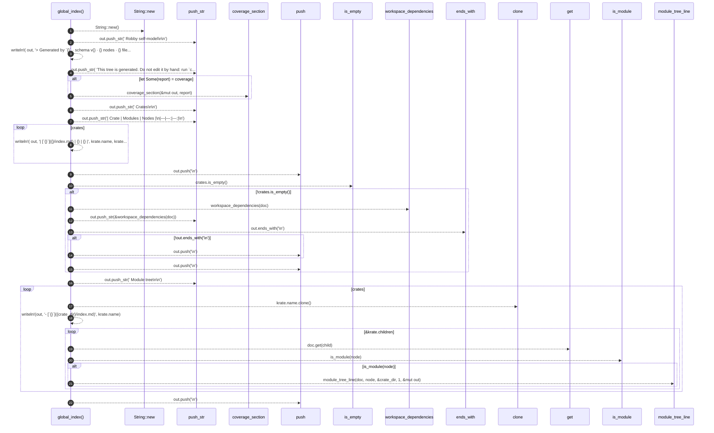

# `robby_render::tree::global_index`

[Self-model](../../README.md) · [tree](index.md)

| | |
|---|---|
| kind | `code.function` |
| signature | `fn global_index(doc: &Document, coverage: Option<&CoverageReport>, crates: &[&Node]) -> String` |
| location | [`crates/robby-render/src/tree.rs:131`](../../../../crates/robby-render/src/tree.rs#L131) |
| provenance | extractor · confidence 1.00 |

```rust
fn global_index(doc: &Document, coverage: Option<&CoverageReport>, crates: &[&Node]) -> String {
    let mut out = String::new();
    out.push_str("# Robby self-model\n\n");
    let _ = writeln!(
        out,
        "> Generated by `{}` · schema v{} · {} nodes · {} files\n",
        doc.generator,
        doc.schema_version,
        doc.nodes.len(),
        doc.files.len()
    );
    out.push_str(
        "This tree is generated. Do not edit it by hand: run `cargo run -p robby-cli -- report`.\n\n",
    );

    if let Some(report) = coverage {
        coverage_section(&mut out, report);
    }

    out.push_str("## Crates\n\n");
    out.push_str("| Crate | Modules | Nodes |\n|---|---:|---:|\n");
    for krate in crates {
        let _ = writeln!(
            out,
            "| [`{}`]({}/index.md) | {} | {} |",
            krate.name,
            krate.name,
            count_modules(doc, krate),
            doc.subtree(&krate.id).len()
        );
    }
    out.push('\n');

    if !crates.is_empty() {
        out.push_str(&workspace_dependencies(doc));
        if !out.ends_with('\n') {
            out.push('\n');
        }
        out.push('\n');
    }

    out.push_str("## Module tree\n\n");
    for krate in crates {
        let crate_dir = krate.name.clone();
        let _ = writeln!(out, "- [`{}`]({crate_dir}/index.md)", krate.name);
        for child in &krate.children {
            let Some(node) = doc.get(child) else { continue };
            if is_module(node) {
                module_tree_line(doc, node, &crate_dir, 1, &mut out);
            }
        }
    }
    out.push('\n');

    out
}
```



22 steps · 0 observed · 22 possible only

**Edges**

- calls → [`robby_render::report::impl Report::new`](../report/index.md)
- calls → [`robby_render::markdown::coverage_section`](../markdown/coverage-section.md)
- calls → [`robby_render::report::impl Report::push`](../report/index.md)
- calls → [`robby_render::view::links::impl LinkGraph::is_empty`](../view/links/index.md)
- calls → [`robby_render::workspace_dependencies`](../workspace-dependencies.md)
- calls → [`robby_render::report::impl Report::push`](../report/index.md)
- calls → [`robby_render::report::impl Report::push`](../report/index.md)
- calls → [`robby_ir::model::impl Document::get`](../../robby_ir/model/index.md)
- calls → [`robby_render::tree::is_module`](is-module.md)
- calls → [`robby_render::tree::module_tree_line`](module-tree-line.md)
- calls → [`robby_render::report::impl Report::push`](../report/index.md)

## References

- calls → [`robby_ir::model`](../../robby_ir/model/index.md) — get
- calls → [`robby_render`](../index.md) — workspace_dependencies
- calls → [`robby_render::markdown`](../markdown/index.md) — coverage_section
- calls → [`robby_render::report`](../report/index.md) — new, push
- calls → [`robby_render::tree`](index.md) — is_module, module_tree_line
- calls → [`robby_render::view::links`](../view/links/index.md) — is_empty

## Referenced by

- calls ← [`robby_render::tree::tree`](tree.md)

