# `robby_render::tree`

[Self-model](../../README.md) · [robby_render](../index.md)

| | |
|---|---|
| kind | `code.module` |
| declared at | [`crates/robby-render/src/lib.rs:10`](../../../../crates/robby-render/src/lib.rs#L10) |
| provenance | extractor · confidence 1.00 |
| nodes | 36 |

```mermaid
flowchart TD
    subgraph n_d59428013b05fa6e["tree [module]"]
        direction TB
        n_47770650c94d41b9["Page [struct]"]
        n_a4770263504cd0ce["fn tree( doc: &Document, coverage: Option<&CoverageReport>, sources: Option<&BTreeMap<String, String>>, out_rel: &str, ) -> Vec<Page> [function]"]
        n_f346ae5659ae42d1["fn module_pages( doc: &Document, node: &Node, crate_dir: &str, pages: &mut Vec<Page>, sources: Option<&BTreeMap<String, String>>, out_rel: &str, ) [function]"]
        n_eaf247f5644149ed["fn item_children<'a>(doc: &'a Document, node: &Node) -> Vec<&'a Node> [function]"]
        n_11a23e983625805a["fn item_slugs(items: &[&Node]) -> BTreeMap<NodeId, String> [function]"]
        n_a3553c31416c47fa["fn global_index(doc: &Document, coverage: Option<&CoverageReport>, crates: &[&Node]) -> String [function]"]
        n_c548f4f208a3b71a["fn module_tree_line( doc: &Document, node: &Node, crate_dir: &str, depth: usize, out: &mut String, ) [function]"]
        n_d84657d79773bf18["fn module_page( doc: &Document, node: &Node, crate_dir: &str, sources: Option<&BTreeMap<String, String>>, out_rel: &str, ) -> String [function]"]
        n_9bff590e84167ba9["fn item_page( doc: &Document, node: &Node, page: &Path, sources: Option<&BTreeMap<String, String>>, out_rel: &str, ) -> String [function]"]
        n_a09f9f042f43ca1b["fn nav(doc: &Document, node: &Node, page: &Path, item: bool) -> String [function]"]
        n_465de596eb56125b["fn render_node( out: &mut String, doc: &Document, node: &Node, depth: usize, page: &Path, sources: Option<&BTreeMap<String, String>>, out_rel: &str, emit_heading: bool, ) [function]"]
        n_22c884af901eb923["fn crate_of(node: &Node) -> Option<String> [function]"]
        n_fdfc429b571e713a["fn is_crate(node: &Node) -> bool [function]"]
        n_ebf19a6a762f1087["fn is_module(node: &Node) -> bool [function]"]
        n_41a4b741f0d97cfa["fn is_module_kind(kind_name: &str) -> bool [function]"]
        n_6de8c81bdaacb2c4["fn is_compact(kind_name: &str) -> bool [function]"]
        n_7f2a8756106a28dc["fn crate_index_path(crate_dir: &str) -> PathBuf [function]"]
        n_562f41d40a0543b1["fn module_index_path(node: &Node, crate_dir: &str) -> Option<PathBuf> [function]"]
        n_01ad3ceef0d0cb80["fn page_of_node(doc: &Document, node: &Node) -> Option<PathBuf> [function]"]
        n_17c77dd7a6fb25ba["fn rel_link(from: &Path, to: &Path) -> String [function]"]
        n_c4f8d8f7672aa0e0["fn source_link(page: &Path, out_rel: &str, span: &robby_ir::Span) -> String [function]"]
        n_9f77a6e59badeee8["fn slice<'a>(sources: &'a BTreeMap<String, String>, span: &robby_ir::Span) -> Option<&'a str> [function]"]
        n_d7e28b7b7f1708a7["fn first_line(text: &str) -> String [function]"]
        n_6b907e7f03293147["fn count_modules(doc: &Document, krate: &Node) -> usize [function]"]
        n_bc43405b8f831fa6["fn short_fqn(node: &Node, crate_dir: &str) -> String [function]"]
        n_da411402b4350d4d["fn item_slug(name: &str, id: &NodeId, used: &mut BTreeSet<String>) -> String [function]"]
        n_129070ef9a7be2e6["fn page_paths(doc: &Document) -> Vec<PathBuf> [function]"]
    end
    n_01ad3ceef0d0cb80 -->|calls| n_11a23e983625805a
    n_01ad3ceef0d0cb80 -->|calls| n_22c884af901eb923
    n_01ad3ceef0d0cb80 -->|calls| n_562f41d40a0543b1
    n_01ad3ceef0d0cb80 -->|calls| n_eaf247f5644149ed
    n_11a23e983625805a -->|calls| n_da411402b4350d4d
    n_465de596eb56125b -->|calls| n_465de596eb56125b
    n_9bff590e84167ba9 -->|calls| n_465de596eb56125b
    n_a3553c31416c47fa -->|calls| n_c548f4f208a3b71a
    n_a4770263504cd0ce -->|calls| n_f346ae5659ae42d1
    n_c548f4f208a3b71a -->|calls| n_562f41d40a0543b1
    n_c548f4f208a3b71a -->|calls| n_c548f4f208a3b71a
    n_d84657d79773bf18 -->|calls| n_11a23e983625805a
    n_ebf19a6a762f1087 -->|calls| n_41a4b741f0d97cfa
    n_f346ae5659ae42d1 -->|calls| n_11a23e983625805a
    n_f346ae5659ae42d1 -->|calls| n_562f41d40a0543b1
    n_f346ae5659ae42d1 -->|calls| n_eaf247f5644149ed
    n_f346ae5659ae42d1 -->|calls| n_f346ae5659ae42d1
```

## Items

| Item | Kind | Steps | Location |
|---|---|---:|---|
| [`Page`](page.md) | `code.struct` | — | `crates/robby-render/src/tree.rs:26:1` |
| [`tree`](tree.md) | `code.function` | 6 | `crates/robby-render/src/tree.rs:32:1` |
| [`module_pages`](module-pages.md) | `code.function` | 10 | `crates/robby-render/src/tree.rs:63:1` |
| [`item_children`](item-children.md) | `code.function` | 1 | `crates/robby-render/src/tree.rs:101:1` |
| [`item_slugs`](item-slugs.md) | `code.function` | 6 | `crates/robby-render/src/tree.rs:112:1` |
| [`global_index`](global-index.md) | `code.function` | 16 | `crates/robby-render/src/tree.rs:128:1` |
| [`module_tree_line`](module-tree-line.md) | `code.function` | 5 | `crates/robby-render/src/tree.rs:177:1` |
| [`module_page`](module-page.md) | `code.function` | 40 | `crates/robby-render/src/tree.rs:203:1` |
| [`item_page`](item-page.md) | `code.function` | 5 | `crates/robby-render/src/tree.rs:325:1` |
| [`nav`](nav.md) | `code.function` | 10 | `crates/robby-render/src/tree.rs:340:1` |
| [`render_node`](render-node.md) | `code.function` | 34 | `crates/robby-render/src/tree.rs:389:1` |
| [`crate_of`](crate-of.md) | `code.function` | 1 | `crates/robby-render/src/tree.rs:512:1` |
| [`is_crate`](is-crate.md) | `code.function` | 1 | `crates/robby-render/src/tree.rs:516:1` |
| [`is_module`](is-module.md) | `code.function` | 1 | `crates/robby-render/src/tree.rs:520:1` |
| [`is_module_kind`](is-module-kind.md) | `code.function` | 1 | `crates/robby-render/src/tree.rs:524:1` |
| [`is_compact`](is-compact.md) | `code.function` | 1 | `crates/robby-render/src/tree.rs:528:1` |
| [`crate_index_path`](crate-index-path.md) | `code.function` | 1 | `crates/robby-render/src/tree.rs:535:1` |
| [`module_index_path`](module-index-path.md) | `code.function` | 5 | `crates/robby-render/src/tree.rs:539:1` |
| [`page_of_node`](page-of-node.md) | `code.function` | 14 | `crates/robby-render/src/tree.rs:551:1` |
| [`rel_link`](rel-link.md) | `code.function` | 8 | `crates/robby-render/src/tree.rs:581:1` |
| [`source_link`](source-link.md) | `code.function` | 4 | `crates/robby-render/src/tree.rs:613:1` |
| [`slice`](slice.md) | `code.function` | 1 | `crates/robby-render/src/tree.rs:624:1` |
| [`first_line`](first-line.md) | `code.function` | 1 | `crates/robby-render/src/tree.rs:630:1` |
| [`count_modules`](count-modules.md) | `code.function` | 1 | `crates/robby-render/src/tree.rs:634:1` |
| [`short_fqn`](short-fqn.md) | `code.function` | 1 | `crates/robby-render/src/tree.rs:641:1` |
| [`item_slug`](item-slug.md) | `code.function` | 11 | `crates/robby-render/src/tree.rs:648:1` |
| [`page_paths`](page-paths.md) | `code.function` | 1 | `crates/robby-render/src/tree.rs:675:1` |

## Imports

- `use std::collections::{BTreeMap, BTreeSet};`
- `use std::fmt::Write as _;`
- `use std::path::{Path, PathBuf};`
- `use robby_ir::{CoverageReport, Document, Node, NodeId, kind};`
- `use crate::markdown::{cell, coverage_section, edge_name, source_name};`
- `use crate::{flowchart, sequence};`

