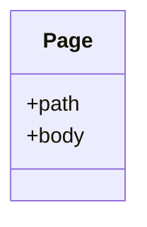
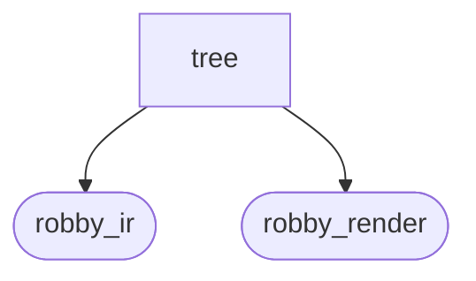
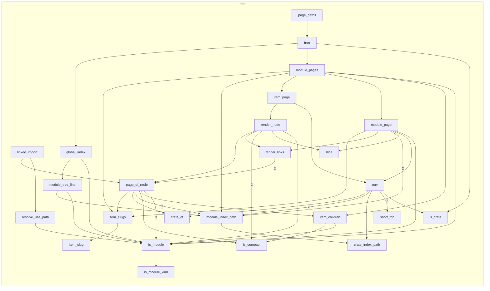

# `robby_render::tree`

[Self-model](../../README.md) · [robby_render](../index.md)

| | |
|---|---|
| kind | `code.module` |
| declared at | [`crates/robby-render/src/lib.rs:15`](../../../../crates/robby-render/src/lib.rs#L15) |
| provenance | extractor · confidence 1.00 |
| nodes | 42 |

## Types



## Package diagram



## Module coupling



## Dependency matrix

| | tree | robby_ir | robby_render |
|---|---:|---:|---:|
| **tree** | · | 31 | 88 |
| **robby_ir** | | · | |
| **robby_render** | | | · |

## Comments

- `crates/robby-render/src/tree.rs:104:1` (docs, `robby_render::tree::item_children`): "Direct, non-module, non-trivial children of a module, in source order."
  ```
  /// Direct, non-module, non-trivial children of a module, in source order.
  fn item_children<'a>(doc: &'a Document, node: &Node) -> Vec<&'a Node> {
      node.children
          .iter()
          .filter_map(|child| doc.get(child))
          .filter(|child| !is_module(child) && !is_compact(child.kind.as_str()))
          .collect()
  }
  ```
- `crates/robby-render/src/tree.rs:113:1` (docs, `robby_render::tree::item_slugs`): "Page slugs for a module's items. `index` is reserved for the module page."
  ```
  /// Page slugs for a module's items. `index` is reserved for the module page.
  fn item_slugs(items: &[&Node]) -> BTreeMap<NodeId, String> {
      let mut used = BTreeSet::new();
      used.insert("index".to_owned());
      let mut slugs = BTreeMap::new();
      for item in items {
          let slug = item_slug(&item.name, &item.id, &mut used);
          slugs.insert(item.id.clone(), slug);
      }
      slugs
  }
  ```
- `crates/robby-render/src/tree.rs:208:1` (docs, `robby_render::tree::module_page`): "A module page: what is in here, and where to go next."
  ```
  /// A module page: what is in here, and where to go next.
  fn module_page(
      doc: &Document,
      node: &Node,
      crate_dir: &str,
      sources: Option<&BTreeMap<String, String>>,
      out_rel: &str,
  ) -> String {
      let mut out = String::new();
      let page = module_index_path(node, crate_dir).unwrap_or_else(|| PathBuf::from("README.md"));
  
      let _ = writeln!(out, "# `{}`\n", node.fqn);
      out.push_str(&nav(doc, node, &page, false));
  
      let _ = writeln!(out, "| | |");
      let _ = writeln!(out, "|---|---|");
      let _ = writeln!(out, "| kind | `{}` |", node.kind);
      if let Some(span) = &node.span {
          let _ = writeln!(
              out,
              "| declared at | {} |",
              source_link(&page, out_rel, span)
          );
      }
      let _ = writeln!(
          out,
          "| provenance | {} · confidence {:.2} |",
          node.provenance.source.as_str(),
          node.provenance.confidence
      );
      let _ = writeln!(out, "| nodes | {} |", doc.subtree(&node.id).len());
      out.push('\n');
  
      if let Some(docs) = &node.docs {
          for line in docs.lines() {
              let _ = writeln!(out, "> {line}");
          }
          out.push('\n');
      }
  
      let children: Vec<&Node> = node
          .children
          .iter()
          .filter_map(|child| doc.get(child))
          .collect();
  
      // Views → rendered sections → report artifact (one formal diagram per concern).
      let views = collect(
          doc,
          node,
          sources,
          &SelectOpts {
              hierarchy: false,
              hierarchy_depth: 0,
              hierarchy_all: false,
              sibling: false,
              source: false,
              types: true,
              dependencies: true,
              externals: true,
              comments: true,
              links: true,
              entry: true,
              process: false,
          },
      );
      let md = MarkdownRenderer::new();
      let mut report = Report::new();
      if let Some(entry) = &views.entry {
          report.push_titled("Entry", md.process(entry));
      }
      if let Some(types) = &views.types {
          report.push_titled("Types", md.types(types));
      }
      if let Some(deps) = &views.dependencies {
          for section in md.dependency_sections(deps) {
              report.push(section);
          }
      }
      if let Some(externals) = &views.externals {
          report.push_titled("Externals", md.externals(externals));
      }
      if let Some(comments) = &views.comments {
          report.push_titled("Comments", md.comments(comments));
      }
      out.push_str(&report.to_markdown());
      out.push_str(&render_links(doc, &views.links, &page));
  
      let submodules: Vec<&&Node> = children.iter().filter(|c| is_module(c)).collect();
      if !submodules.is_empty() {
          out.push_str("## Modules\n\n");
          for sub in submodules {
              if let Some(target) = module_index_path(sub, crate_dir) {
                  let _ = writeln!(
                      out,
                      "- [`{}`]({}) — {} nodes",
                      short_fqn(sub, crate_dir),
                      rel_link(&page, &target),
                      doc.subtree(&sub.id).len()
                  );
              }
          }
          out.push('\n');
      }
  
      let mut imports: Vec<&Node> = Vec::new();
      let mut items: Vec<&Node> = Vec::new();
      for child in &children {
          match child.kind.as_str() {
              kind::code::IMPORT => imports.push(child),
              k if is_module_kind(k) => {}
              k if is_compact(k) => {}
              _ => items.push(child),
          }
      }
  
      if !items.is_empty() {
          let module_dir = page.parent().unwrap_or(Path::new("."));
          let slugs = item_slugs(&items);
          out.push_str("## Items\n\n");
          out.push_str("| Item | Kind | Steps | Location |\n|---|---|---:|---|\n");
          for item in items {
              let Some(slug) = slugs.get(&item.id) else {
                  continue;
              };
              let target = module_dir.join(format!("{slug}.md"));
              let location = item
                  .span
                  .as_ref()
                  .map_or_else(|| "—".to_owned(), robby_ir::Span::location);
              let steps = item
                  .process
                  .as_ref()
                  .map_or_else(|| "—".to_owned(), |process| process.steps.len().to_string());
              let _ = writeln!(
                  out,
                  "| [`{}`]({}) | `{}` | {} | `{}` |",
                  item.name,
                  rel_link(&page, &target),
                  item.kind,
                  steps,
                  location
              );
          }
          out.push('\n');
      }
  
      if !imports.is_empty() {
          out.push_str("## Imports\n\n");
          for import in imports {
              let text = sources
                  .and_then(|s| import.span.as_ref().and_then(|span| slice(s, span)))
                  .map_or_else(|| import.name.clone(), first_line);
              let _ = writeln!(out, "- {}", linked_import(doc, &page, &text));
          }
          out.push('\n');
      }
  
      out
  }
  ```
- `crates/robby-render/src/tree.rs:29:1` (docs, `robby_render::tree::Page`): "One generated page."
  ```
  /// One generated page.
  pub struct Page {
      pub path: PathBuf,
      pub body: String,
  }
  ```
- `crates/robby-render/src/tree.rs:35:1` (docs, `robby_render::tree::tree`): "Build every page of the self-model. `out_rel` is the output directory relative to the workspace root, e.g. `docs/self-m…"
  ```
  /// Build every page of the self-model.
  ///
  /// `out_rel` is the output directory relative to the workspace root, e.g.
  /// `docs/self-model`. It is only used to compute links back to source files.
  pub fn tree(
      doc: &Document,
      coverage: Option<&CoverageReport>,
      sources: Option<&BTreeMap<String, String>>,
      out_rel: &str,
  ) -> Vec<Page> {
      let mut pages = Vec::new();
  
      let crates: Vec<&Node> = doc.nodes.values().filter(|node| is_crate(node)).collect();
  
      pages.push(Page {
          path: PathBuf::from("README.md"),
          body: global_index(doc, coverage, &crates),
      });
  
      for krate in crates {
          let crate_dir = krate.name.clone();
          module_pages(doc, krate, &crate_dir, &mut pages, sources, out_rel);
      }
  
      pages
  }
  ```
- `crates/robby-render/src/tree.rs:369:1` (docs, `robby_render::tree::item_page`): "An item page: the source, its process, its edges."
  ```
  /// An item page: the source, its process, its edges.
  fn item_page(
      doc: &Document,
      node: &Node,
      page: &Path,
      sources: Option<&BTreeMap<String, String>>,
      out_rel: &str,
  ) -> String {
      let mut out = String::new();
      let _ = writeln!(out, "# `{}`\n", node.fqn);
      out.push_str(&nav(doc, node, page, true));
      render_node(&mut out, doc, node, 2, page, sources, out_rel, false);
      out
  }
  ```
- `crates/robby-render/src/tree.rs:562:1` (docs, `robby_render::tree::render_links`): "Render a [`LinkGraph`] as markdown with resolved page paths."
  ```
  /// Render a [`LinkGraph`] as markdown with resolved page paths.
  fn render_links(doc: &Document, links: &LinkGraph, page: &Path) -> String {
      if links.is_empty() {
          return String::new();
      }
  
      let mut out = String::new();
      if !links.outbound.is_empty() {
          out.push_str("## References\n\n");
          for link in &links.outbound {
              let Some(module) = doc.get(&link.module_id) else {
                  continue;
              };
              let Some(target_page) = page_of_node(doc, module) else {
                  continue;
              };
              let detail = if link.items.len() <= 4 {
                  format!(" — {}", link.items.join(", "))
              } else {
                  format!(" — {} items", link.items.len())
              };
              let _ = writeln!(
                  out,
                  "- {} → [`{}`]({}){detail}",
                  link.kind_label,
                  link.module_fqn,
                  rel_link(page, &target_page)
              );
          }
          out.push('\n');
      }
  
      if !links.inbound.is_empty() {
          out.push_str("## Referenced by\n\n");
          for link in &links.inbound {
              let kinds = link.kinds.join(", ");
              let Some(caller) = doc.get(&link.caller_id) else {
                  let _ = writeln!(out, "- {kinds} ← `{}`", link.caller_fqn);
                  continue;
              };
              match page_of_node(doc, caller) {
                  Some(target_page) => {
                      let _ = writeln!(
                          out,
                          "- {kinds} ← [`{}`]({})",
                          link.caller_fqn,
                          rel_link(page, &target_page)
                      );
                  }
                  None => {
                      let _ = writeln!(out, "- {kinds} ← `{}`", link.caller_fqn);
                  }
              }
          }
          out.push('\n');
      }
  
      out
  }
  ```
- `crates/robby-render/src/tree.rs:708:1` (docs, `robby_render::tree::module_index_path`): "`<crate>/<a>/<b>/index.md` for a module, `<crate>/index.md` for the crate root."
  ```
  /// `<crate>/<a>/<b>/index.md` for a module, `<crate>/index.md` for the crate root.
  fn module_index_path(node: &Node, crate_dir: &str) -> Option<PathBuf> {
      if node.fqn == crate_dir {
          return Some(crate_index_path(crate_dir));
      }
      let rest = node
          .fqn
          .strip_prefix(&format!("{crate_dir}::"))
          .or_else(|| node.fqn.strip_prefix(&format!("{crate_dir}/")))?;
      Some(PathBuf::from(format!(
          "{crate_dir}/{}/index.md",
          rest.replace("::", "/")
      )))
  }
  ```
- `crates/robby-render/src/tree.rs:723:1` (docs, `robby_render::tree::page_of_node`): "The most specific page for a node: its item page if it has one."
  ```
  /// The most specific page for a node: its item page if it has one.
  fn page_of_node(doc: &Document, node: &Node) -> Option<PathBuf> {
      let crate_dir = crate_of(node);
  
      if !is_module(node)
          && !is_compact(node.kind.as_str())
          && let Some(parent) = node.parent.as_ref().and_then(|id| doc.get(id))
          && is_module(parent)
          && let Some(index) = module_index_path(parent, &crate_dir)
      {
          let module_dir = index.parent().unwrap_or(Path::new("."));
          let items = item_children(doc, parent);
          let slugs = item_slugs(&items);
          if let Some(slug) = slugs.get(&node.id) {
              return Some(module_dir.join(format!("{slug}.md")));
          }
      }
  
      let mut current = Some(node.id.clone());
      while let Some(id) = current {
          let candidate = doc.get(&id)?;
          if is_module(candidate) {
              return module_index_path(candidate, &crate_dir);
          }
          // `while let` moves `current`, so this has to be a fresh assignment.
          #[allow(clippy::assigning_clones)]
          {
              current = candidate.parent.clone();
          }
      }
      None
  }
  ```
- `crates/robby-render/src/tree.rs:756:1` (docs, `robby_render::tree::rel_link`): "Relative link from one page to another. Both are relative to the output root."
  ```
  /// Relative link from one page to another. Both are relative to the output root.
  fn rel_link(from: &Path, to: &Path) -> String {
      let from_dir: Vec<String> = from
          .parent()
          .map(|parent| {
              parent
                  .components()
                  .map(|c| c.as_os_str().to_string_lossy().to_string())
                  .collect()
          })
          .unwrap_or_default();
      let to_parts: Vec<String> = to
          .components()
          .map(|c| c.as_os_str().to_string_lossy().to_string())
          .collect();
  
      let mut common = 0;
      while common < from_dir.len()
          && common + 1 < to_parts.len()
          && from_dir[common] == to_parts[common]
      {
          common += 1;
      }
  
      let mut out = String::new();
      for _ in common..from_dir.len() {
          out.push_str("../");
      }
      out.push_str(&to_parts[common..].join("/"));
      out
  }
  ```
- `crates/robby-render/src/tree.rs:788:1` (docs, `robby_render::tree::source_link`): "A link from a generated page back to the exact source span."
  ```
  /// A link from a generated page back to the exact source span.
  fn source_link(page: &Path, out_rel: &str, span: &robby_ir::Span) -> String {
      let out_depth = out_rel.split('/').filter(|s| !s.is_empty()).count();
      let page_depth = page.parent().map_or(0, |p| p.components().count());
      let prefix = "../".repeat(out_depth + page_depth);
      format!(
          "[`{}:{}`]({}{}#L{})",
          span.file, span.start.line, prefix, span.file, span.start.line
      )
  }
  ```
- `crates/robby-render/src/tree.rs:823:1` (docs, `robby_render::tree::item_slug`): "A filesystem-safe, human-readable page name, disambiguated on collision."
  ```
  /// A filesystem-safe, human-readable page name, disambiguated on collision.
  fn item_slug(name: &str, id: &NodeId, used: &mut BTreeSet<String>) -> String {
      let mut base = String::new();
      for ch in name.chars() {
          if ch.is_ascii_alphanumeric() {
              base.push(ch.to_ascii_lowercase());
          } else if !base.is_empty() && !base.ends_with('-') {
              base.push('-');
          }
      }
      while base.ends_with('-') {
          base.pop();
      }
      if base.is_empty() {
          base.push_str("item");
      }
  
      if used.insert(base.clone()) {
          return base;
      }
  
      let suffix = crate::stable_id(id.as_str());
      let alt = format!("{base}-{}", &suffix[..suffix.len().min(8)]);
      used.insert(alt.clone());
      alt
  }
  ```
- `crates/robby-render/src/tree.rs:850:1` (docs, `robby_render::tree::page_paths`): "Every page path a document will produce, for tests and stale-file cleanup."
  ```
  /// Every page path a document will produce, for tests and stale-file cleanup.
  pub fn page_paths(doc: &Document) -> Vec<PathBuf> {
      tree(doc, None, None, "docs/self-model")
          .into_iter()
          .map(|page| page.path)
          .collect()
  }
  ```
## References

- calls → [`robby_ir::kind`](../../robby_ir/kind/index.md) — from
- calls → [`robby_ir::model`](../../robby_ir/model/index.md) — insert, subtree, symbol
- calls → [`robby_ir::run`](../../robby_ir/run/index.md) — get
- calls → [`robby_render`](../index.md) — sequence, stable_id, workspace_dependencies
- calls → [`robby_render::markdown`](../markdown/index.md) — coverage_section
- calls → [`robby_render::render`](../render/index.md) — comments, dependency_sections, externals, types
- calls → [`robby_render::report`](../report/index.md) — new, push, push_titled, to_markdown
- calls → [`robby_render::test_render`](../test_render/index.md) — process
- calls → [`robby_render::view::comments`](../view/comments/index.md) — as_str
- calls → [`robby_render::view::links`](../view/links/index.md) — for_node, is_empty
- calls → [`robby_render::view::select`](../view/select/index.md) — collect

## Items

| Item | Kind | Steps | Location |
|---|---|---:|---|
| [`Page`](page.md) | `code.struct` | — | `crates/robby-render/src/tree.rs:29:1` |
| [`tree`](tree.md) | `code.function` | 10 | `crates/robby-render/src/tree.rs:35:1` |
| [`module_pages`](module-pages.md) | `code.function` | 19 | `crates/robby-render/src/tree.rs:62:1` |
| [`item_children`](item-children.md) | `code.function` | 8 | `crates/robby-render/src/tree.rs:104:1` |
| [`item_slugs`](item-slugs.md) | `code.function` | 7 | `crates/robby-render/src/tree.rs:113:1` |
| [`global_index`](global-index.md) | `code.function` | 22 | `crates/robby-render/src/tree.rs:129:1` |
| [`module_tree_line`](module-tree-line.md) | `code.function` | 6 | `crates/robby-render/src/tree.rs:186:1` |
| [`module_page`](module-page.md) | `code.function` | 82 | `crates/robby-render/src/tree.rs:208:1` |
| [`item_page`](item-page.md) | `code.function` | 5 | `crates/robby-render/src/tree.rs:369:1` |
| [`nav`](nav.md) | `code.function` | 30 | `crates/robby-render/src/tree.rs:384:1` |
| [`render_node`](render-node.md) | `code.function` | 57 | `crates/robby-render/src/tree.rs:436:1` |
| [`render_links`](render-links.md) | `code.function` | 21 | `crates/robby-render/src/tree.rs:562:1` |
| [`linked_import`](linked-import.md) | `code.function` | 5 | `crates/robby-render/src/tree.rs:622:1` |
| [`resolve_use_path`](resolve-use-path.md) | `code.function` | 23 | `crates/robby-render/src/tree.rs:629:1` |
| [`crate_of`](crate-of.md) | `code.function` | 7 | `crates/robby-render/src/tree.rs:670:1` |
| [`is_crate`](is-crate.md) | `code.function` | 1 | `crates/robby-render/src/tree.rs:682:1` |
| [`is_module`](is-module.md) | `code.function` | 2 | `crates/robby-render/src/tree.rs:686:1` |
| [`is_module_kind`](is-module-kind.md) | `code.function` | 1 | `crates/robby-render/src/tree.rs:690:1` |
| [`is_compact`](is-compact.md) | `code.function` | 1 | `crates/robby-render/src/tree.rs:697:1` |
| [`crate_index_path`](crate-index-path.md) | `code.function` | 2 | `crates/robby-render/src/tree.rs:704:1` |
| [`module_index_path`](module-index-path.md) | `code.function` | 12 | `crates/robby-render/src/tree.rs:708:1` |
| [`page_of_node`](page-of-node.md) | `code.function` | 27 | `crates/robby-render/src/tree.rs:723:1` |
| [`rel_link`](rel-link.md) | `code.function` | 22 | `crates/robby-render/src/tree.rs:756:1` |
| [`source_link`](source-link.md) | `code.function` | 10 | `crates/robby-render/src/tree.rs:788:1` |
| [`slice`](slice.md) | `code.function` | 3 | `crates/robby-render/src/tree.rs:799:1` |
| [`first_line`](first-line.md) | `code.function` | 5 | `crates/robby-render/src/tree.rs:805:1` |
| [`count_modules`](count-modules.md) | `code.function` | 5 | `crates/robby-render/src/tree.rs:809:1` |
| [`short_fqn`](short-fqn.md) | `code.function` | 4 | `crates/robby-render/src/tree.rs:816:1` |
| [`item_slug`](item-slug.md) | `code.function` | 20 | `crates/robby-render/src/tree.rs:823:1` |
| [`page_paths`](page-paths.md) | `code.function` | 4 | `crates/robby-render/src/tree.rs:850:1` |

## Imports

- `use std::collections::{BTreeMap, BTreeSet};`
- `use std::fmt::Write as _;`
- `use std::path::{Path, PathBuf};`
- [`use robby_ir::{CoverageReport, Document, Node, NodeId, kind};`](../../robby_ir/index.md)
- `use crate::markdown::{cell, coverage_section};`
- `use crate::render::{MarkdownRenderer, Renderer};`
- `use crate::report::Report;`
- `use crate::view::{LinkGraph, SelectOpts, collect};`
- `use crate::{sequence, workspace_dependencies};`

