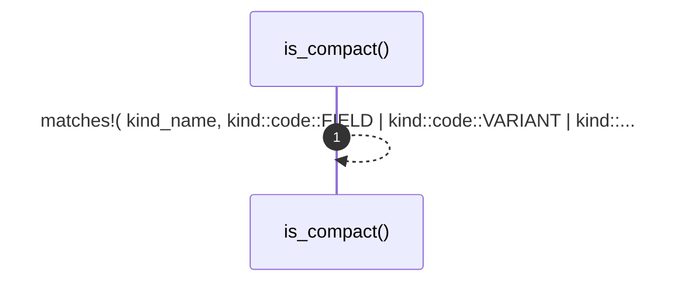

# `robby_render::tree::is_compact`

[Self-model](../../README.md) · [tree](index.md)

| | |
|---|---|
| kind | `code.function` |
| signature | `fn is_compact(kind_name: &str) -> bool` |
| location | [`crates/robby-render/src/tree.rs:528`](../../../../crates/robby-render/src/tree.rs#L528) |
| provenance | extractor · confidence 1.00 |

```rust
fn is_compact(kind_name: &str) -> bool {
    matches!(
        kind_name,
        kind::code::FIELD | kind::code::VARIANT | kind::code::IMPORT
    )
}
```



1 steps · 0 observed · 1 possible only

