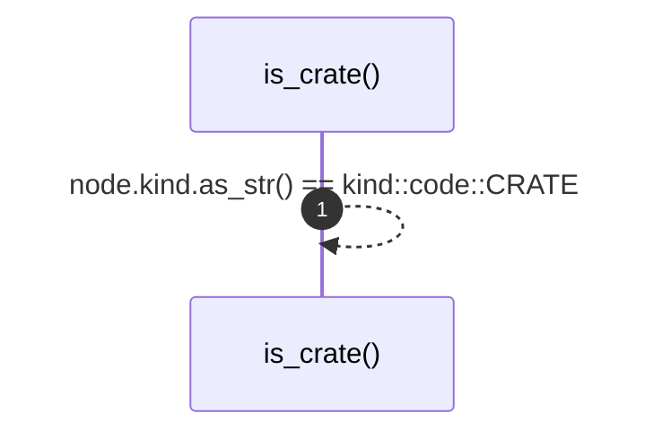

# `robby_render::tree::is_crate`

[Self-model](../../README.md) · [tree](index.md)

| | |
|---|---|
| kind | `code.function` |
| signature | `fn is_crate(node: &Node) -> bool` |
| location | [`crates/robby-render/src/tree.rs:516`](../../../../crates/robby-render/src/tree.rs#L516) |
| provenance | extractor · confidence 1.00 |

```rust
fn is_crate(node: &Node) -> bool {
    node.kind.as_str() == kind::code::CRATE
}
```



1 steps · 0 observed · 1 possible only

