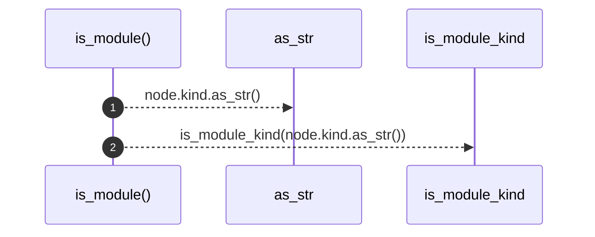

# `robby_render::tree::is_module`

[Self-model](../../README.md) · [tree](index.md)

| | |
|---|---|
| kind | `code.function` |
| signature | `fn is_module(node: &Node) -> bool` |
| location | [`crates/robby-render/src/tree.rs:686`](../../../../crates/robby-render/src/tree.rs#L686) |
| provenance | extractor · confidence 1.00 |

```rust
fn is_module(node: &Node) -> bool {
    is_module_kind(node.kind.as_str())
}
```



2 steps · 0 observed · 2 possible only

**Edges**

- calls → [`robby_render::view::comments::impl CommentKind::as_str`](../view/comments/index.md)
- calls → [`robby_render::tree::is_module_kind`](is-module-kind.md)

## References

- calls → [`robby_render::tree`](index.md) — is_module_kind
- calls → [`robby_render::view::comments`](../view/comments/index.md) — as_str

## Referenced by

- calls ← [`robby_render::tree::global_index`](global-index.md)
- calls ← [`robby_render::tree::item_children`](item-children.md)
- calls ← [`robby_render::tree::module_page`](module-page.md)
- calls ← [`robby_render::tree::module_pages`](module-pages.md)
- calls ← [`robby_render::tree::module_tree_line`](module-tree-line.md)
- calls ← [`robby_render::tree::page_of_node`](page-of-node.md)
- calls ← [`robby_render::tree::render_node`](render-node.md)
- calls ← [`robby_render::tree::resolve_use_path`](resolve-use-path.md)

