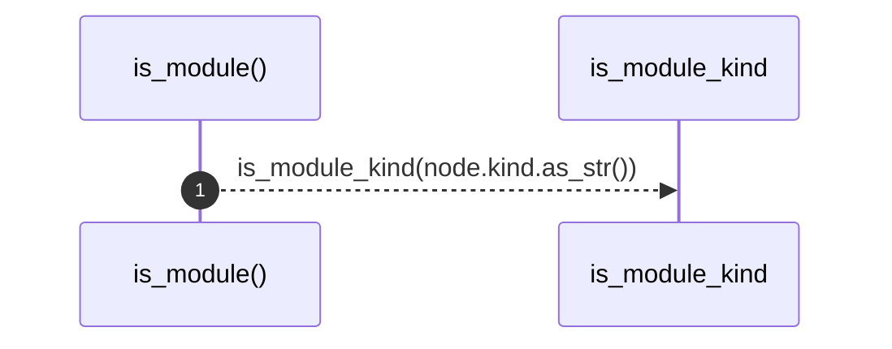

# `robby_render::tree::is_module`

[Self-model](../../README.md) · [tree](index.md)

| | |
|---|---|
| kind | `code.function` |
| signature | `fn is_module(node: &Node) -> bool` |
| location | [`crates/robby-render/src/tree.rs:520`](../../../../crates/robby-render/src/tree.rs#L520) |
| provenance | extractor · confidence 1.00 |

```rust
fn is_module(node: &Node) -> bool {
    is_module_kind(node.kind.as_str())
}
```



1 steps · 0 observed · 1 possible only

**Edges**

- calls → [`robby_render::tree::is_module_kind`](is-module-kind.md)

