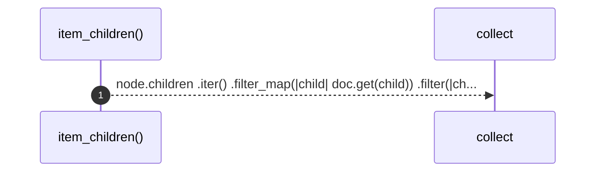

# `robby_render::tree::item_children`

[Self-model](../../README.md) · [tree](index.md)

| | |
|---|---|
| kind | `code.function` |
| signature | `fn item_children<'a>(doc: &'a Document, node: &Node) -> Vec<&'a Node>` |
| location | [`crates/robby-render/src/tree.rs:101`](../../../../crates/robby-render/src/tree.rs#L101) |
| provenance | extractor · confidence 1.00 |

> Direct, non-module, non-trivial children of a module, in source order.

```rust
/// Direct, non-module, non-trivial children of a module, in source order.
fn item_children<'a>(doc: &'a Document, node: &Node) -> Vec<&'a Node> {
    node.children
        .iter()
        .filter_map(|child| doc.get(child))
        .filter(|child| {
            !is_module(child) && !is_compact(child.kind.as_str())
        })
        .collect()
}
```



1 steps · 0 observed · 1 possible only

