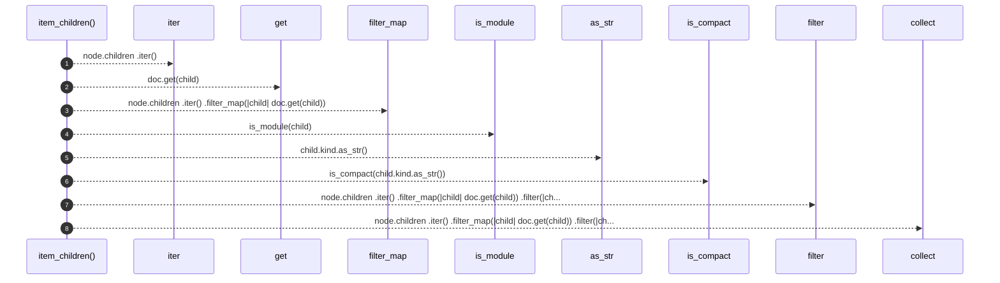

# `robby_render::tree::item_children`

[Self-model](../../README.md) · [tree](index.md)

| | |
|---|---|
| kind | `code.function` |
| signature | `fn item_children<'a>(doc: &'a Document, node: &Node) -> Vec<&'a Node>` |
| location | [`crates/robby-render/src/tree.rs:104`](../../../../crates/robby-render/src/tree.rs#L104) |
| provenance | extractor · confidence 1.00 |

> Direct, non-module, non-trivial children of a module, in source order.

```rust
/// Direct, non-module, non-trivial children of a module, in source order.
fn item_children<'a>(doc: &'a Document, node: &Node) -> Vec<&'a Node> {
    node.children
        .iter()
        .filter_map(|child| doc.get(child))
        .filter(|child| !is_module(child) && !is_compact(child.kind.as_str()))
        .collect()
}
```



8 steps · 0 observed · 8 possible only

**Edges**

- calls → [`robby_ir::run::RecipeCatalog::get`](../../robby_ir/run/index.md)
- calls → [`robby_render::tree::is_module`](is-module.md)
- calls → [`robby_render::view::comments::impl CommentKind::as_str`](../view/comments/index.md)
- calls → [`robby_render::tree::is_compact`](is-compact.md)
- calls → [`robby_render::view::select::collect`](../view/select/collect.md)

## References

- calls → [`robby_ir::run`](../../robby_ir/run/index.md) — get
- calls → [`robby_render::tree`](index.md) — is_compact, is_module
- calls → [`robby_render::view::comments`](../view/comments/index.md) — as_str
- calls → [`robby_render::view::select`](../view/select/index.md) — collect

## Referenced by

- calls ← [`robby_render::tree::module_pages`](module-pages.md)
- calls ← [`robby_render::tree::page_of_node`](page-of-node.md)

