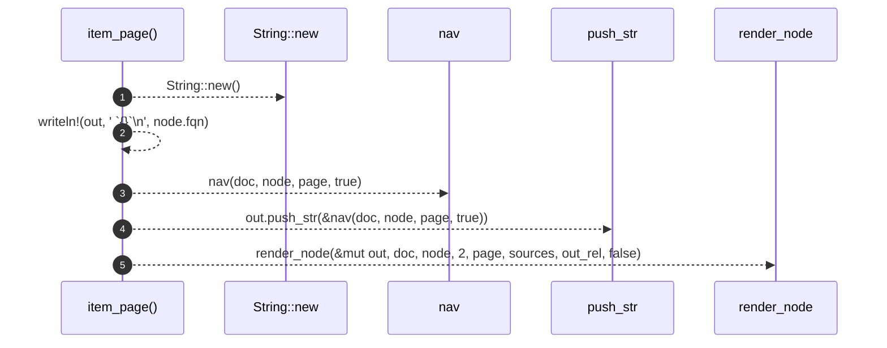

# `robby_render::tree::item_page`

[Self-model](../../README.md) · [tree](index.md)

| | |
|---|---|
| kind | `code.function` |
| signature | `fn item_page(     doc: &Document,     node: &Node,     page: &Path,     sources: Option<&BTreeMap<String, String>>,     out_rel: &str, ) -> String` |
| location | [`crates/robby-render/src/tree.rs:369`](../../../../crates/robby-render/src/tree.rs#L369) |
| provenance | extractor · confidence 1.00 |

> An item page: the source, its process, its edges.

```rust
/// An item page: the source, its process, its edges.
fn item_page(
    doc: &Document,
    node: &Node,
    page: &Path,
    sources: Option<&BTreeMap<String, String>>,
    out_rel: &str,
) -> String {
    let mut out = String::new();
    let _ = writeln!(out, "# `{}`\n", node.fqn);
    out.push_str(&nav(doc, node, page, true));
    render_node(&mut out, doc, node, 2, page, sources, out_rel, false);
    out
}
```



5 steps · 0 observed · 5 possible only

**Edges**

- calls → [`robby_render::report::impl Report::new`](../report/index.md)
- calls → [`robby_render::tree::nav`](nav.md)
- calls → [`robby_render::tree::render_node`](render-node.md)

## References

- calls → [`robby_render::report`](../report/index.md) — new
- calls → [`robby_render::tree`](index.md) — nav, render_node

## Referenced by

- calls ← [`robby_render::tree::module_pages`](module-pages.md)

