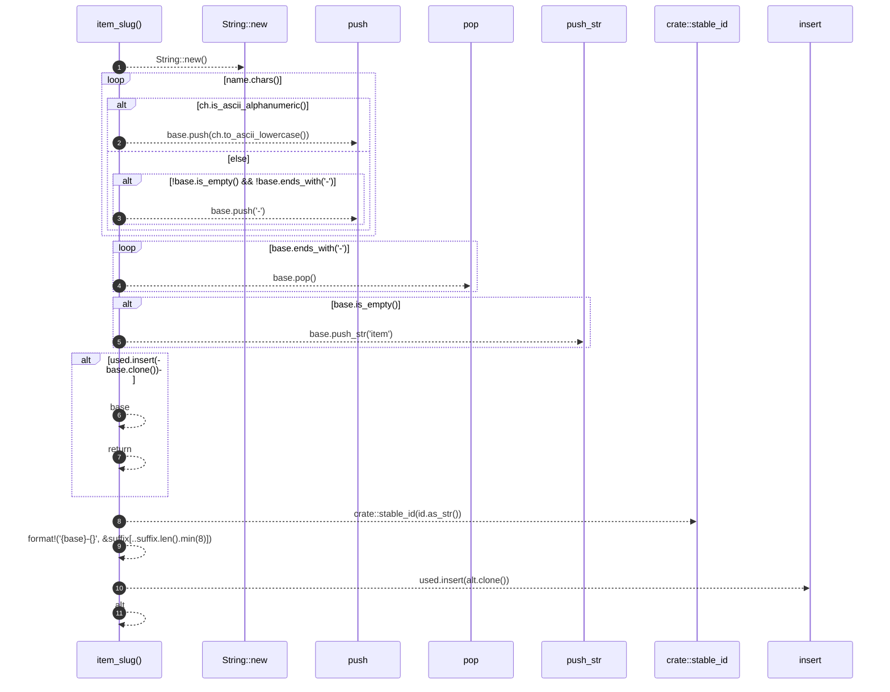

# `robby_render::tree::item_slug`

[Self-model](../../README.md) · [tree](index.md)

| | |
|---|---|
| kind | `code.function` |
| signature | `fn item_slug(name: &str, id: &NodeId, used: &mut BTreeSet<String>) -> String` |
| location | [`crates/robby-render/src/tree.rs:648`](../../../../crates/robby-render/src/tree.rs#L648) |
| provenance | extractor · confidence 1.00 |

> A filesystem-safe, human-readable page name, disambiguated on collision.

```rust
/// A filesystem-safe, human-readable page name, disambiguated on collision.
fn item_slug(name: &str, id: &NodeId, used: &mut BTreeSet<String>) -> String {
    let mut base = String::new();
    for ch in name.chars() {
        if ch.is_ascii_alphanumeric() {
            base.push(ch.to_ascii_lowercase());
        } else if !base.is_empty() && !base.ends_with('-') {
            base.push('-');
        }
    }
    while base.ends_with('-') {
        base.pop();
    }
    if base.is_empty() {
        base.push_str("item");
    }

    if used.insert(base.clone()) {
        return base;
    }

    let suffix = crate::stable_id(id.as_str());
    let alt = format!("{base}-{}", &suffix[..suffix.len().min(8)]);
    used.insert(alt.clone());
    alt
}
```



11 steps · 0 observed · 11 possible only

**Edges**

- calls → [`robby_extract::impl LineIndex::new`](../../robby_extract/index.md)
- calls → [`robby_render::stable_id`](../stable-id.md)
- calls → [`robby_ir::model::impl Document::insert`](../../robby_ir/model/index.md)

