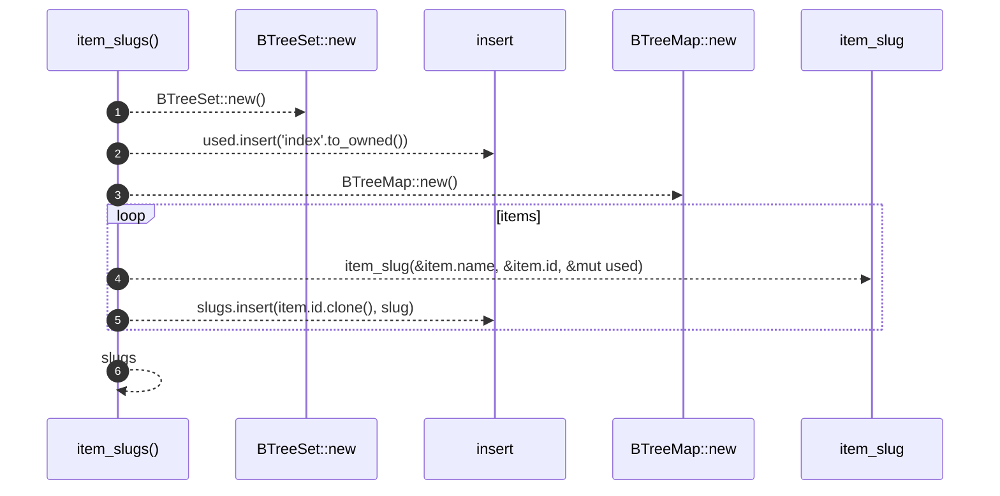

# `robby_render::tree::item_slugs`

[Self-model](../../README.md) · [tree](index.md)

| | |
|---|---|
| kind | `code.function` |
| signature | `fn item_slugs(items: &[&Node]) -> BTreeMap<NodeId, String>` |
| location | [`crates/robby-render/src/tree.rs:112`](../../../../crates/robby-render/src/tree.rs#L112) |
| provenance | extractor · confidence 1.00 |

> Page slugs for a module's items. `index` is reserved for the module page.

```rust
/// Page slugs for a module's items. `index` is reserved for the module page.
fn item_slugs(items: &[&Node]) -> BTreeMap<NodeId, String> {
    let mut used = BTreeSet::new();
    used.insert("index".to_owned());
    let mut slugs = BTreeMap::new();
    for item in items {
        let slug = item_slug(&item.name, &item.id, &mut used);
        slugs.insert(item.id.clone(), slug);
    }
    slugs
}
```



6 steps · 0 observed · 6 possible only

**Edges**

- calls → [`robby_extract::impl LineIndex::new`](../../robby_extract/index.md)
- calls → [`robby_ir::model::impl Document::insert`](../../robby_ir/model/index.md)
- calls → [`robby_extract::impl LineIndex::new`](../../robby_extract/index.md)
- calls → [`robby_render::tree::item_slug`](item-slug.md)
- calls → [`robby_ir::model::impl Document::insert`](../../robby_ir/model/index.md)

