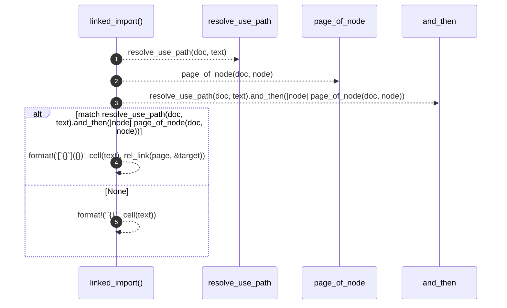

# `robby_render::tree::linked_import`

[Self-model](../../README.md) · [tree](index.md)

| | |
|---|---|
| kind | `code.function` |
| signature | `fn linked_import(doc: &Document, page: &Path, text: &str) -> String` |
| location | [`crates/robby-render/src/tree.rs:624`](../../../../crates/robby-render/src/tree.rs#L624) |
| provenance | extractor · confidence 1.00 |

```rust
fn linked_import(doc: &Document, page: &Path, text: &str) -> String {
    match resolve_use_path(doc, text).and_then(|node| page_of_node(doc, node)) {
        Some(target) => format!("[`{}`]({})", cell(text), rel_link(page, &target)),
        None => format!("`{}`", cell(text)),
    }
}
```



5 steps · 0 observed · 5 possible only

**Edges**

- calls → [`robby_render::tree::resolve_use_path`](resolve-use-path.md)
- calls → [`robby_render::tree::page_of_node`](page-of-node.md)

## References

- calls → [`robby_render::tree`](index.md) — page_of_node, resolve_use_path

