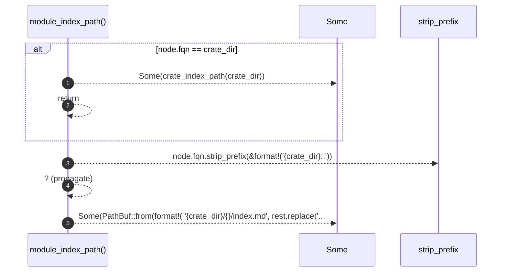

# `robby_render::tree::module_index_path`

[Self-model](../../README.md) · [tree](index.md)

| | |
|---|---|
| kind | `code.function` |
| signature | `fn module_index_path(node: &Node, crate_dir: &str) -> Option<PathBuf>` |
| location | [`crates/robby-render/src/tree.rs:539`](../../../../crates/robby-render/src/tree.rs#L539) |
| provenance | extractor · confidence 1.00 |

> `<crate>/<a>/<b>/index.md` for a module, `<crate>/index.md` for the crate root.

```rust
/// `<crate>/<a>/<b>/index.md` for a module, `<crate>/index.md` for the crate root.
fn module_index_path(node: &Node, crate_dir: &str) -> Option<PathBuf> {
    if node.fqn == crate_dir {
        return Some(crate_index_path(crate_dir));
    }
    let rest = node.fqn.strip_prefix(&format!("{crate_dir}::"))?;
    Some(PathBuf::from(format!(
        "{crate_dir}/{}/index.md",
        rest.replace("::", "/")
    )))
}
```



5 steps · 0 observed · 5 possible only

