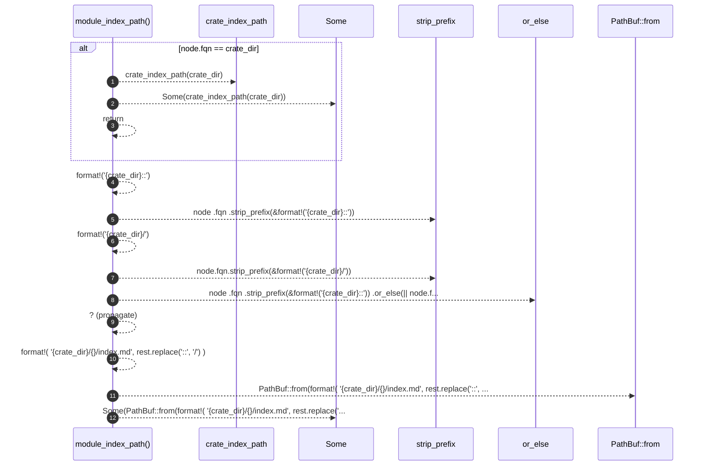

# `robby_render::tree::module_index_path`

[Self-model](../../README.md) · [tree](index.md)

| | |
|---|---|
| kind | `code.function` |
| signature | `fn module_index_path(node: &Node, crate_dir: &str) -> Option<PathBuf>` |
| location | [`crates/robby-render/src/tree.rs:715`](../../../../crates/robby-render/src/tree.rs#L715) |
| provenance | extractor · confidence 1.00 |

> `<crate>/<a>/<b>/index.md` for a module, `<crate>/index.md` for the crate root.

```rust
/// `<crate>/<a>/<b>/index.md` for a module, `<crate>/index.md` for the crate root.
fn module_index_path(node: &Node, crate_dir: &str) -> Option<PathBuf> {
    if node.fqn == crate_dir {
        return Some(crate_index_path(crate_dir));
    }
    let rest = node
        .fqn
        .strip_prefix(&format!("{crate_dir}::"))
        .or_else(|| node.fqn.strip_prefix(&format!("{crate_dir}/")))?;
    Some(PathBuf::from(format!(
        "{crate_dir}/{}/index.md",
        rest.replace("::", "/")
    )))
}
```



12 steps · 0 observed · 12 possible only

**Edges**

- calls → [`robby_render::tree::crate_index_path`](crate-index-path.md)
- calls → [`robby_ir::kind::impl From<&str> for Kind::from`](../../robby_ir/kind/index.md)

## References

- calls → [`robby_ir::kind`](../../robby_ir/kind/index.md) — from
- calls → [`robby_render::tree`](index.md) — crate_index_path

## Referenced by

- calls ← [`robby_render::tree::module_page`](module-page.md)
- calls ← [`robby_render::tree::module_pages`](module-pages.md)
- calls ← [`robby_render::tree::module_tree_line`](module-tree-line.md)
- calls ← [`robby_render::tree::nav`](nav.md)
- calls ← [`robby_render::tree::page_of_node`](page-of-node.md)

