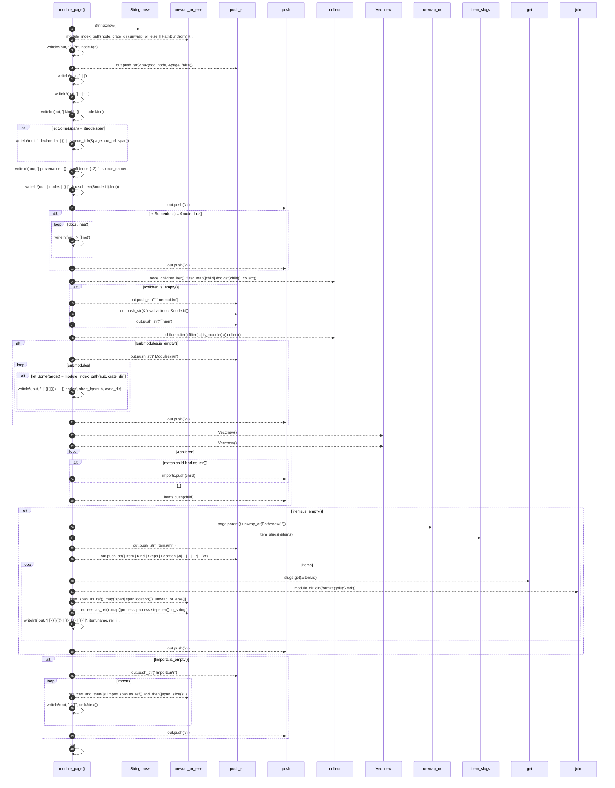

# `robby_render::tree::module_page`

[Self-model](../../README.md) · [tree](index.md)

| | |
|---|---|
| kind | `code.function` |
| signature | `fn module_page(     doc: &Document,     node: &Node,     crate_dir: &str,     sources: Option<&BTreeMap<String, String>>,     out_rel: &str, ) -> String` |
| location | [`crates/robby-render/src/tree.rs:203`](../../../../crates/robby-render/src/tree.rs#L203) |
| provenance | extractor · confidence 1.00 |

> A module page: what is in here, and where to go next.

```rust
/// A module page: what is in here, and where to go next.
fn module_page(
    doc: &Document,
    node: &Node,
    crate_dir: &str,
    sources: Option<&BTreeMap<String, String>>,
    out_rel: &str,
) -> String {
    let mut out = String::new();
    let page = module_index_path(node, crate_dir).unwrap_or_else(|| PathBuf::from("README.md"));

    let _ = writeln!(out, "# `{}`\n", node.fqn);
    out.push_str(&nav(doc, node, &page, false));

    let _ = writeln!(out, "| | |");
    let _ = writeln!(out, "|---|---|");
    let _ = writeln!(out, "| kind | `{}` |", node.kind);
    if let Some(span) = &node.span {
        let _ = writeln!(out, "| declared at | {} |", source_link(&page, out_rel, span));
    }
    let _ = writeln!(
        out,
        "| provenance | {} · confidence {:.2} |",
        source_name(node.provenance.source),
        node.provenance.confidence
    );
    let _ = writeln!(out, "| nodes | {} |", doc.subtree(&node.id).len());
    out.push('\n');

    if let Some(docs) = &node.docs {
        for line in docs.lines() {
            let _ = writeln!(out, "> {line}");
        }
        out.push('\n');
    }

    let children: Vec<&Node> = node
        .children
        .iter()
        .filter_map(|child| doc.get(child))
        .collect();

    if !children.is_empty() {
        out.push_str("```mermaid\n");
        out.push_str(&flowchart(doc, &node.id));
        out.push_str("```\n\n");
    }

    let submodules: Vec<&&Node> = children.iter().filter(|c| is_module(c)).collect();
    if !submodules.is_empty() {
        out.push_str("## Modules\n\n");
        for sub in submodules {
            if let Some(target) = module_index_path(sub, crate_dir) {
                let _ = writeln!(
                    out,
                    "- [`{}`]({}) — {} nodes",
                    short_fqn(sub, crate_dir),
                    rel_link(&page, &target),
                    doc.subtree(&sub.id).len()
                );
            }
        }
        out.push('\n');
    }

    let mut imports: Vec<&Node> = Vec::new();
    let mut items: Vec<&Node> = Vec::new();
    for child in &children {
        match child.kind.as_str() {
            kind::code::IMPORT => imports.push(child),
            k if is_module_kind(k) => {}
            k if is_compact(k) => {}
            _ => items.push(child),
        }
    }

    if !items.is_empty() {
        let module_dir = page.parent().unwrap_or(Path::new("."));
        let slugs = item_slugs(&items);
        out.push_str("## Items\n\n");
        out.push_str("| Item | Kind | Steps | Location |\n|---|---|---:|---|\n");
        for item in items {
            let Some(slug) = slugs.get(&item.id) else { continue };
            let target = module_dir.join(format!("{slug}.md"));
            let location = item
                .span
                .as_ref()
                .map(|span| span.location())
                .unwrap_or_else(|| "—".to_owned());
            let steps = item
                .process
                .as_ref()
                .map(|process| process.steps.len().to_string())
                .unwrap_or_else(|| "—".to_owned());
            let _ = writeln!(
                out,
                "| [`{}`]({}) | `{}` | {} | `{}` |",
                item.name,
                rel_link(&page, &target),
                item.kind,
                steps,
                location
            );
        }
        out.push('\n');
    }

    if !imports.is_empty() {
        out.push_str("## Imports\n\n");
        for import in imports {
            let text = sources
                .and_then(|s| import.span.as_ref().and_then(|span| slice(s, span)))
                .map(|text| first_line(&text))
                .unwrap_or_else(|| import.name.clone());
            let _ = writeln!(out, "- `{}`", cell(&text));
        }
        out.push('\n');
    }

    out
}
```



40 steps · 0 observed · 40 possible only

**Edges**

- calls → [`robby_extract::impl LineIndex::new`](../../robby_extract/index.md)
- calls → [`robby_extract::impl LineIndex::new`](../../robby_extract/index.md)
- calls → [`robby_extract::impl LineIndex::new`](../../robby_extract/index.md)
- calls → [`robby_render::tree::item_slugs`](item-slugs.md)
- calls → [`robby_ir::model::impl Document::get`](../../robby_ir/model/index.md)

