# `robby_render::tree::module_page`

[Self-model](../../README.md) · [tree](index.md)

| | |
|---|---|
| kind | `code.function` |
| signature | `fn module_page(     doc: &Document,     node: &Node,     crate_dir: &str,     sources: Option<&BTreeMap<String, String>>,     out_rel: &str, ) -> String` |
| location | [`crates/robby-render/src/tree.rs:214`](../../../../crates/robby-render/src/tree.rs#L214) |
| provenance | extractor · confidence 1.00 |

> A module page: what is in here, and where to go next.

```rust
/// A module page: what is in here, and where to go next.
fn module_page(
    doc: &Document,
    node: &Node,
    crate_dir: &str,
    sources: Option<&BTreeMap<String, String>>,
    out_rel: &str,
) -> String {
    let mut out = String::new();
    let page = module_index_path(node, crate_dir).unwrap_or_else(|| PathBuf::from("README.md"));

    let _ = writeln!(out, "# `{}`\n", node.fqn);
    out.push_str(&nav(doc, node, &page, false));

    let _ = writeln!(out, "| | |");
    let _ = writeln!(out, "|---|---|");
    let _ = writeln!(out, "| kind | `{}` |", node.kind);
    if let Some(span) = &node.span {
        let _ = writeln!(out, "| declared at | {} |", source_link(&page, out_rel, span));
    }
    let _ = writeln!(
        out,
        "| provenance | {} · confidence {:.2} |",
        source_name(node.provenance.source),
        node.provenance.confidence
    );
    let _ = writeln!(out, "| nodes | {} |", doc.subtree(&node.id).len());
    out.push('\n');

    if let Some(docs) = &node.docs {
        for line in docs.lines() {
            let _ = writeln!(out, "> {line}");
        }
        out.push('\n');
    }

    let children: Vec<&Node> = node
        .children
        .iter()
        .filter_map(|child| doc.get(child))
        .collect();

    // Views → rendered sections → report artifact (one formal diagram per concern).
    let views = collect(
        doc,
        node,
        sources,
        &SelectOpts {
            hierarchy: false,
            hierarchy_depth: 0,
            hierarchy_all: false,
            sibling: false,
            source: false,
            types: true,
            dependencies: true,
            externals: true,
            comments: true,
            links: true,
            entry: true,
            process: false,
        },
    );
    let md = MarkdownRenderer::new();
    let mut report = Report::new();
    if let Some(entry) = &views.entry {
        report.push_titled("Entry", md.process(entry));
    }
    if let Some(types) = &views.types {
        report.push_titled("Types", md.types(types));
    }
    if let Some(deps) = &views.dependencies {
        for section in md.dependency_sections(deps) {
            report.push(section);
        }
    }
    if let Some(externals) = &views.externals {
        report.push_titled("Externals", md.externals(externals));
    }
    if let Some(comments) = &views.comments {
        report.push_titled("Comments", md.comments(comments));
    }
    out.push_str(&report.to_markdown());
    out.push_str(&render_links(doc, &views.links, &page));

    let submodules: Vec<&&Node> = children.iter().filter(|c| is_module(c)).collect();
    if !submodules.is_empty() {
        out.push_str("## Modules\n\n");
        for sub in submodules {
            if let Some(target) = module_index_path(sub, crate_dir) {
                let _ = writeln!(
                    out,
                    "- [`{}`]({}) — {} nodes",
                    short_fqn(sub, crate_dir),
                    rel_link(&page, &target),
                    doc.subtree(&sub.id).len()
                );
            }
        }
        out.push('\n');
    }

    let mut imports: Vec<&Node> = Vec::new();
    let mut items: Vec<&Node> = Vec::new();
    for child in &children {
        match child.kind.as_str() {
            kind::code::IMPORT => imports.push(child),
            k if is_module_kind(k) => {}
            k if is_compact(k) => {}
            _ => items.push(child),
        }
    }

    if !items.is_empty() {
        let module_dir = page.parent().unwrap_or(Path::new("."));
        let slugs = item_slugs(&items);
        out.push_str("## Items\n\n");
        out.push_str("| Item | Kind | Steps | Location |\n|---|---|---:|---|\n");
        for item in items {
            let Some(slug) = slugs.get(&item.id) else { continue };
            let target = module_dir.join(format!("{slug}.md"));
            let location = item
                .span
                .as_ref()
                .map(|span| span.location())
                .unwrap_or_else(|| "—".to_owned());
            let steps = item
                .process
                .as_ref()
                .map(|process| process.steps.len().to_string())
                .unwrap_or_else(|| "—".to_owned());
            let _ = writeln!(
                out,
                "| [`{}`]({}) | `{}` | {} | `{}` |",
                item.name,
                rel_link(&page, &target),
                item.kind,
                steps,
                location
            );
        }
        out.push('\n');
    }

    if !imports.is_empty() {
        out.push_str("## Imports\n\n");
        for import in imports {
            let text = sources
                .and_then(|s| import.span.as_ref().and_then(|span| slice(s, span)))
                .map(|text| first_line(&text))
                .unwrap_or_else(|| import.name.clone());
            let _ = writeln!(out, "- {}", linked_import(doc, &page, &text));
        }
        out.push('\n');
    }

    out
}
```

```mermaid
sequenceDiagram
    autonumber
    participant module_page as module_page()
    participant String__new as String::new
    participant module_index_path as module_index_path
    participant PathBuf__from as PathBuf::from
    participant unwrap_or_else as unwrap_or_else
    participant nav as nav
    participant push_str as push_str
    participant push as push
    participant lines as lines
    participant iter as iter
    participant get as get
    participant filter_map as filter_map
    participant collect as collect
    participant MarkdownRenderer__new as MarkdownRenderer::new
    participant Report__new as Report::new
    participant process as process
    participant push_titled as push_titled
    participant types as types
    participant dependency_sections as dependency_sections
    participant externals as externals
    participant comments as comments
    participant to_markdown as to_markdown
    participant render_links as render_links
    participant is_module as is_module
    participant filter as filter
    participant is_empty as is_empty
    participant Vec__new as Vec::new
    participant as_str as as_str
    participant parent as parent
    participant Path__new as Path::new
    participant unwrap_or as unwrap_or
    participant item_slugs as item_slugs
    participant join as join
    participant as_ref as as_ref
    participant location as location
    participant map as map
    participant to_owned as to_owned
    participant len as len
    participant to_string as to_string
    participant slice as slice
    participant and_then as and_then
    participant first_line as first_line
    participant clone as clone
    module_page-->>String__new: String::new()
    module_page-->>module_index_path: module_index_path(node, crate_dir)
    module_page-->>PathBuf__from: PathBuf::from('README.md')
    module_page-->>unwrap_or_else: module_index_path(node, crate_dir).unwrap_or_else(|| PathBuf::from('R...
    module_page-->>module_page: writeln!(out, ' `{}`\n', node.fqn)
    module_page-->>nav: nav(doc, node, &page, false)
    module_page-->>push_str: out.push_str(&nav(doc, node, &page, false))
    module_page-->>module_page: writeln!(out, '| | |')
    module_page-->>module_page: writeln!(out, '|---|---|')
    module_page-->>module_page: writeln!(out, '| kind | `{}` |', node.kind)
    alt let Some(span) = &node.span
    module_page-->>module_page: writeln!(out, '| declared at | {} |', source_link(&page, out_rel, span))
    end
    module_page-->>module_page: writeln!( out, '| provenance | {} · confidence {:.2} |', source_name(...
    module_page-->>module_page: writeln!(out, '| nodes | {} |', doc.subtree(&node.id).len())
    module_page-->>push: out.push('\n')
    alt let Some(docs) = &node.docs
    module_page-->>lines: docs.lines()
    loop docs.lines()
    module_page-->>module_page: writeln!(out, '> {line}')
    end
    module_page-->>push: out.push('\n')
    end
    module_page-->>iter: node .children .iter()
    module_page-->>get: doc.get(child)
    module_page-->>filter_map: node .children .iter() .filter_map(|child| doc.get(child))
    module_page-->>collect: node .children .iter() .filter_map(|child| doc.get(child)) .collect()
    module_page-->>collect: collect( doc, node, sources, &SelectOpts { hierarchy: false, hierarch...
    module_page-->>MarkdownRenderer__new: MarkdownRenderer::new()
    module_page-->>Report__new: Report::new()
    alt let Some(entry) = &views.entry
    module_page-->>process: md.process(entry)
    module_page-->>push_titled: report.push_titled('Entry', md.process(entry))
    end
    alt let Some(types) = &views.types
    module_page-->>types: md.types(types)
    module_page-->>push_titled: report.push_titled('Types', md.types(types))
    end
    alt let Some(deps) = &views.dependencies
    module_page-->>dependency_sections: md.dependency_sections(deps)
    loop md.dependency_sections(deps)
    module_page-->>push: report.push(section)
    end
    end
    alt let Some(externals) = &views.externals
    module_page-->>externals: md.externals(externals)
    module_page-->>push_titled: report.push_titled('Externals', md.externals(externals))
    end
    alt let Some(comments) = &views.comments
    module_page-->>comments: md.comments(comments)
    module_page-->>push_titled: report.push_titled('Comments', md.comments(comments))
    end
    module_page-->>to_markdown: report.to_markdown()
    module_page-->>push_str: out.push_str(&report.to_markdown())
    module_page-->>render_links: render_links(doc, &views.links, &page)
    module_page-->>push_str: out.push_str(&render_links(doc, &views.links, &page))
    module_page-->>iter: children.iter()
    module_page-->>is_module: is_module(c)
    module_page-->>filter: children.iter().filter(|c| is_module(c))
    module_page-->>collect: children.iter().filter(|c| is_module(c)).collect()
    module_page-->>is_empty: submodules.is_empty()
    alt !submodules.is_empty()
    module_page-->>push_str: out.push_str(' Modules\n\n')
    loop submodules
    module_page-->>module_index_path: module_index_path(sub, crate_dir)
    alt let Some(target) = module_index_path(sub, crate_dir)
    module_page-->>module_page: writeln!( out, '- [`{}`]({}) — {} nodes', short_fqn(sub, crate_dir), ...
    end
    end
    module_page-->>push: out.push('\n')
    end
    module_page-->>Vec__new: Vec::new()
    module_page-->>Vec__new: Vec::new()
    loop &children
    module_page-->>as_str: child.kind.as_str()
    alt match child.kind.as_str()
    module_page-->>push: imports.push(child)
    else _
    module_page-->>push: items.push(child)
    end
    end
    module_page-->>is_empty: items.is_empty()
    alt !items.is_empty()
    module_page-->>parent: page.parent()
    module_page-->>Path__new: Path::new('.')
    module_page-->>unwrap_or: page.parent().unwrap_or(Path::new('.'))
    module_page-->>item_slugs: item_slugs(&items)
    module_page-->>push_str: out.push_str(' Items\n\n')
    module_page-->>push_str: out.push_str('| Item | Kind | Steps | Location |\n|---|---|---:|---|\n')
    loop items
    module_page-->>get: slugs.get(&item.id)
    module_page-->>module_page: format!('{slug}.md')
    module_page-->>join: module_dir.join(format!('{slug}.md'))
    module_page-->>as_ref: item .span .as_ref()
    module_page-->>location: span.location()
    module_page-->>map: item .span .as_ref() .map(|span| span.location())
    module_page-->>to_owned: '—'.to_owned()
    module_page-->>unwrap_or_else: item .span .as_ref() .map(|span| span.location()) .unwrap_or_else(|| ...
    module_page-->>as_ref: item .process .as_ref()
    module_page-->>len: process.steps.len()
    module_page-->>to_string: process.steps.len().to_string()
    module_page-->>map: item .process .as_ref() .map(|process| process.steps.len().to_string())
    module_page-->>to_owned: '—'.to_owned()
    module_page-->>unwrap_or_else: item .process .as_ref() .map(|process| process.steps.len().to_string(...
    module_page-->>module_page: writeln!( out, '| [`{}`]({}) | `{}` | {} | `{}` |', item.name, rel_li...
    end
    module_page-->>push: out.push('\n')
    end
    module_page-->>is_empty: imports.is_empty()
    alt !imports.is_empty()
    module_page-->>push_str: out.push_str(' Imports\n\n')
    loop imports
    module_page-->>as_ref: import.span.as_ref()
    module_page-->>slice: slice(s, span)
    module_page-->>and_then: import.span.as_ref().and_then(|span| slice(s, span))
    module_page-->>and_then: sources .and_then(|s| import.span.as_ref().and_then(|span| slice(s, s...
    module_page-->>first_line: first_line(&text)
    module_page-->>map: sources .and_then(|s| import.span.as_ref().and_then(|span| slice(s, s...
    module_page-->>clone: import.name.clone()
    module_page-->>unwrap_or_else: sources .and_then(|s| import.span.as_ref().and_then(|span| slice(s, s...
    module_page-->>module_page: writeln!(out, '- {}', linked_import(doc, &page, &text))
    end
    module_page-->>push: out.push('\n')
    end
```



87 steps · 0 observed · 87 possible only

**Edges**

- calls → [`robby_render::report::impl Report::new`](../report/index.md)
- calls → [`robby_render::tree::module_index_path`](module-index-path.md)
- calls → [`robby_ir::kind::impl From<&str> for Kind::from`](../../robby_ir/kind/index.md)
- calls → [`robby_render::tree::nav`](nav.md)
- calls → [`robby_render::report::impl Report::push`](../report/index.md)
- calls → [`robby_render::report::impl Report::push`](../report/index.md)
- calls → [`robby_ir::model::impl Document::get`](../../robby_ir/model/index.md)
- calls → [`robby_render::view::select::collect`](../view/select/collect.md)
- calls → [`robby_render::view::select::collect`](../view/select/collect.md)
- calls → [`robby_render::report::impl Report::new`](../report/index.md)
- calls → [`robby_render::report::impl Report::new`](../report/index.md)
- calls → [`robby_render::test_render::process`](../test_render/process.md)
- calls → [`robby_render::report::impl Report::push_titled`](../report/index.md)
- calls → [`robby_render::render::Renderer::types`](../render/index.md)
- calls → [`robby_render::report::impl Report::push_titled`](../report/index.md)
- calls → [`robby_render::render::Renderer::dependency_sections`](../render/index.md)
- calls → [`robby_render::report::impl Report::push`](../report/index.md)
- calls → [`robby_render::render::Renderer::externals`](../render/index.md)
- calls → [`robby_render::report::impl Report::push_titled`](../report/index.md)
- calls → [`robby_render::render::Renderer::comments`](../render/index.md)
- calls → [`robby_render::report::impl Report::push_titled`](../report/index.md)
- calls → [`robby_render::report::impl Report::to_markdown`](../report/index.md)
- calls → [`robby_render::tree::render_links`](render-links.md)
- calls → [`robby_render::tree::is_module`](is-module.md)
- calls → [`robby_render::view::select::collect`](../view/select/collect.md)
- calls → [`robby_render::view::links::impl LinkGraph::is_empty`](../view/links/index.md)
- calls → [`robby_render::tree::module_index_path`](module-index-path.md)
- calls → [`robby_render::report::impl Report::push`](../report/index.md)
- calls → [`robby_render::report::impl Report::new`](../report/index.md)
- calls → [`robby_render::report::impl Report::new`](../report/index.md)
- calls → [`robby_render::view::comments::impl NoteKind::as_str`](../view/comments/index.md)
- calls → [`robby_render::report::impl Report::push`](../report/index.md)
- calls → [`robby_render::report::impl Report::push`](../report/index.md)
- calls → [`robby_render::view::links::impl LinkGraph::is_empty`](../view/links/index.md)
- calls → [`robby_render::report::impl Report::new`](../report/index.md)
- calls → [`robby_render::tree::item_slugs`](item-slugs.md)
- calls → [`robby_ir::model::impl Document::get`](../../robby_ir/model/index.md)
- calls → [`robby_ir::span::impl Span::location`](../../robby_ir/span/index.md)
- calls → [`robby_render::report::impl Report::push`](../report/index.md)
- calls → [`robby_render::view::links::impl LinkGraph::is_empty`](../view/links/index.md)
- calls → [`robby_render::tree::slice`](slice.md)
- calls → [`robby_render::tree::first_line`](first-line.md)
- calls → [`robby_render::report::impl Report::push`](../report/index.md)

## References

- calls → [`robby_ir::kind`](../../robby_ir/kind/index.md) — from
- calls → [`robby_ir::model`](../../robby_ir/model/index.md) — get
- calls → [`robby_ir::span`](../../robby_ir/span/index.md) — location
- calls → [`robby_render::render`](../render/index.md) — comments, dependency_sections, externals, types
- calls → [`robby_render::report`](../report/index.md) — new, push, push_titled, to_markdown
- calls → [`robby_render::test_render`](../test_render/index.md) — process
- calls → [`robby_render::tree`](index.md) — 7 items
- calls → [`robby_render::view::comments`](../view/comments/index.md) — as_str
- calls → [`robby_render::view::links`](../view/links/index.md) — is_empty
- calls → [`robby_render::view::select`](../view/select/index.md) — collect

## Referenced by

- calls ← [`robby_render::tree::module_pages`](module-pages.md)

