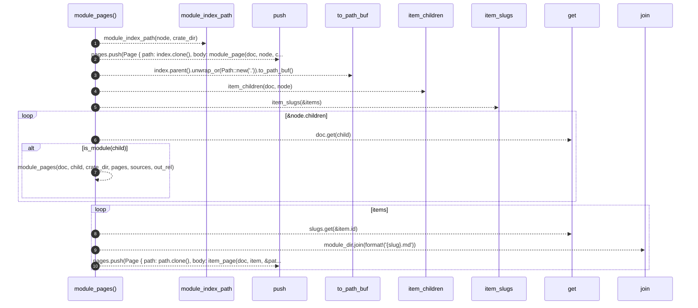

# `robby_render::tree::module_pages`

[Self-model](../../README.md) · [tree](index.md)

| | |
|---|---|
| kind | `code.function` |
| signature | `fn module_pages(     doc: &Document,     node: &Node,     crate_dir: &str,     pages: &mut Vec<Page>,     sources: Option<&BTreeMap<String, String>>,     out_rel: &str, )` |
| location | [`crates/robby-render/src/tree.rs:63`](../../../../crates/robby-render/src/tree.rs#L63) |
| provenance | extractor · confidence 1.00 |

```rust
fn module_pages(
    doc: &Document,
    node: &Node,
    crate_dir: &str,
    pages: &mut Vec<Page>,
    sources: Option<&BTreeMap<String, String>>,
    out_rel: &str,
) {
    let Some(index) = module_index_path(node, crate_dir) else {
        return;
    };

    pages.push(Page {
        path: index.clone(),
        body: module_page(doc, node, crate_dir, sources, out_rel),
    });

    let module_dir = index.parent().unwrap_or(Path::new(".")).to_path_buf();
    let items = item_children(doc, node);
    let slugs = item_slugs(&items);

    for child in &node.children {
        let Some(child) = doc.get(child) else { continue };
        if is_module(child) {
            module_pages(doc, child, crate_dir, pages, sources, out_rel);
        }
    }

    for item in items {
        let Some(slug) = slugs.get(&item.id) else { continue };
        let path = module_dir.join(format!("{slug}.md"));
        pages.push(Page {
            path: path.clone(),
            body: item_page(doc, item, &path, sources, out_rel),
        });
    }
}
```



10 steps · 0 observed · 10 possible only

**Edges**

- calls → [`robby_render::tree::module_index_path`](module-index-path.md)
- calls → [`robby_render::tree::item_children`](item-children.md)
- calls → [`robby_render::tree::item_slugs`](item-slugs.md)
- calls → [`robby_ir::model::impl Document::get`](../../robby_ir/model/index.md)
- calls → [`robby_render::tree::module_pages`](module-pages.md)
- calls → [`robby_ir::model::impl Document::get`](../../robby_ir/model/index.md)

