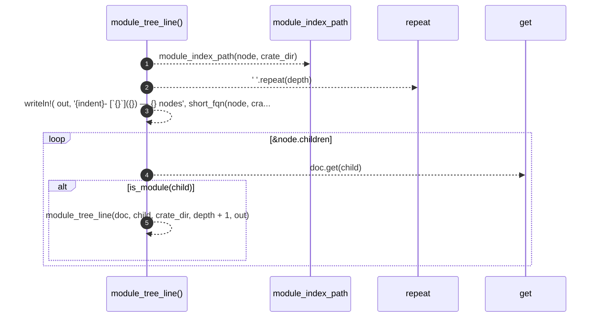

# `robby_render::tree::module_tree_line`

[Self-model](../../README.md) · [tree](index.md)

| | |
|---|---|
| kind | `code.function` |
| signature | `fn module_tree_line(     doc: &Document,     node: &Node,     crate_dir: &str,     depth: usize,     out: &mut String, )` |
| location | [`crates/robby-render/src/tree.rs:177`](../../../../crates/robby-render/src/tree.rs#L177) |
| provenance | extractor · confidence 1.00 |

```rust
fn module_tree_line(
    doc: &Document,
    node: &Node,
    crate_dir: &str,
    depth: usize,
    out: &mut String,
) {
    let Some(index) = module_index_path(node, crate_dir) else {
        return;
    };
    let indent = "  ".repeat(depth);
    let _ = writeln!(
        out,
        "{indent}- [`{}`]({}) — {} nodes",
        short_fqn(node, crate_dir),
        index.to_string_lossy().replace('\\', "/"),
        doc.subtree(&node.id).len()
    );
    for child in &node.children {
        let Some(child) = doc.get(child) else { continue };
        if is_module(child) {
            module_tree_line(doc, child, crate_dir, depth + 1, out);
        }
    }
}
```



5 steps · 0 observed · 5 possible only

**Edges**

- calls → [`robby_render::tree::module_index_path`](module-index-path.md)
- calls → [`robby_ir::model::impl Document::get`](../../robby_ir/model/index.md)
- calls → [`robby_render::tree::module_tree_line`](module-tree-line.md)

