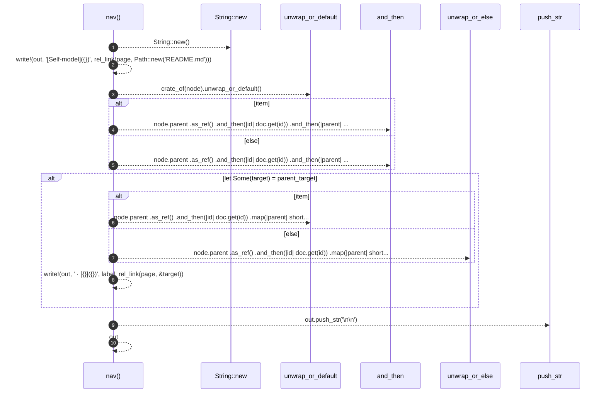

# `robby_render::tree::nav`

[Self-model](../../README.md) · [tree](index.md)

| | |
|---|---|
| kind | `code.function` |
| signature | `fn nav(doc: &Document, node: &Node, page: &Path, item: bool) -> String` |
| location | [`crates/robby-render/src/tree.rs:340`](../../../../crates/robby-render/src/tree.rs#L340) |
| provenance | extractor · confidence 1.00 |

```rust
fn nav(doc: &Document, node: &Node, page: &Path, item: bool) -> String {
    let mut out = String::new();
    let _ = write!(out, "[Self-model]({})", rel_link(page, Path::new("README.md")));

    let crate_dir = crate_of(node).unwrap_or_default();

    let parent_target = if item {
        node.parent
            .as_ref()
            .and_then(|id| doc.get(id))
            .and_then(|parent| module_index_path(parent, &crate_dir))
    } else {
        node.parent
            .as_ref()
            .and_then(|id| doc.get(id))
            .and_then(|parent| {
                if is_crate(parent) {
                    Some(crate_index_path(&crate_dir))
                } else {
                    module_index_path(parent, &crate_dir)
                }
            })
    };

    if let Some(target) = parent_target {
        let label = if item {
            node.parent
                .as_ref()
                .and_then(|id| doc.get(id))
                .map(|parent| short_fqn(parent, &crate_dir))
                .unwrap_or_default()
        } else {
            node.parent
                .as_ref()
                .and_then(|id| doc.get(id))
                .map(|parent| short_fqn(parent, &crate_dir))
                .unwrap_or_else(|| "crate".to_owned())
        };
        let _ = write!(out, " · [{}]({})", label, rel_link(page, &target));
    }

    out.push_str("\n\n");
    out
}
```



10 steps · 0 observed · 10 possible only

**Edges**

- calls → [`robby_extract::impl LineIndex::new`](../../robby_extract/index.md)

