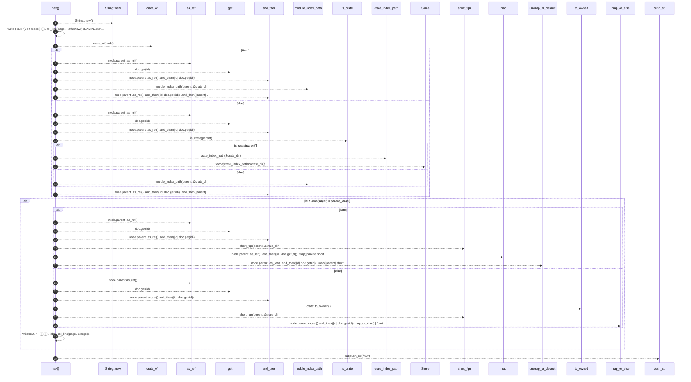

# `robby_render::tree::nav`

[Self-model](../../README.md) · [tree](index.md)

| | |
|---|---|
| kind | `code.function` |
| signature | `fn nav(doc: &Document, node: &Node, page: &Path, item: bool) -> String` |
| location | [`crates/robby-render/src/tree.rs:384`](../../../../crates/robby-render/src/tree.rs#L384) |
| provenance | extractor · confidence 1.00 |

```rust
fn nav(doc: &Document, node: &Node, page: &Path, item: bool) -> String {
    let mut out = String::new();
    let _ = write!(
        out,
        "[Self-model]({})",
        rel_link(page, Path::new("README.md"))
    );

    let crate_dir = crate_of(node);

    let parent_target = if item {
        node.parent
            .as_ref()
            .and_then(|id| doc.get(id))
            .and_then(|parent| module_index_path(parent, &crate_dir))
    } else {
        node.parent
            .as_ref()
            .and_then(|id| doc.get(id))
            .and_then(|parent| {
                if is_crate(parent) {
                    Some(crate_index_path(&crate_dir))
                } else {
                    module_index_path(parent, &crate_dir)
                }
            })
    };

    if let Some(target) = parent_target {
        let label = if item {
            node.parent
                .as_ref()
                .and_then(|id| doc.get(id))
                .map(|parent| short_fqn(parent, &crate_dir))
                .unwrap_or_default()
        } else {
            node.parent.as_ref().and_then(|id| doc.get(id)).map_or_else(
                || "crate".to_owned(),
                |parent| short_fqn(parent, &crate_dir),
            )
        };
        let _ = write!(out, " · [{}]({})", label, rel_link(page, &target));
    }

    out.push_str("\n\n");
    out
}
```



30 steps · 0 observed · 30 possible only

**Edges**

- calls → [`robby_render::report::impl Report::new`](../report/index.md)
- calls → [`robby_render::tree::crate_of`](crate-of.md)
- calls → [`robby_ir::run::RecipeCatalog::get`](../../robby_ir/run/index.md)
- calls → [`robby_render::tree::module_index_path`](module-index-path.md)
- calls → [`robby_ir::run::RecipeCatalog::get`](../../robby_ir/run/index.md)
- calls → [`robby_render::tree::is_crate`](is-crate.md)
- calls → [`robby_render::tree::crate_index_path`](crate-index-path.md)
- calls → [`robby_render::tree::module_index_path`](module-index-path.md)
- calls → [`robby_ir::run::RecipeCatalog::get`](../../robby_ir/run/index.md)
- calls → [`robby_render::tree::short_fqn`](short-fqn.md)
- calls → [`robby_ir::run::RecipeCatalog::get`](../../robby_ir/run/index.md)
- calls → [`robby_render::tree::short_fqn`](short-fqn.md)

## References

- calls → [`robby_ir::run`](../../robby_ir/run/index.md) — get
- calls → [`robby_render::report`](../report/index.md) — new
- calls → [`robby_render::tree`](index.md) — 5 items

## Referenced by

- calls ← [`robby_render::tree::item_page`](item-page.md)
- calls ← [`robby_render::tree::module_page`](module-page.md)

